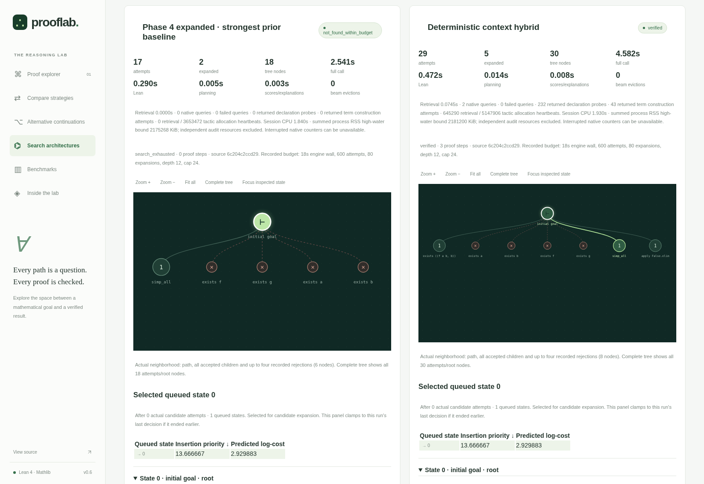
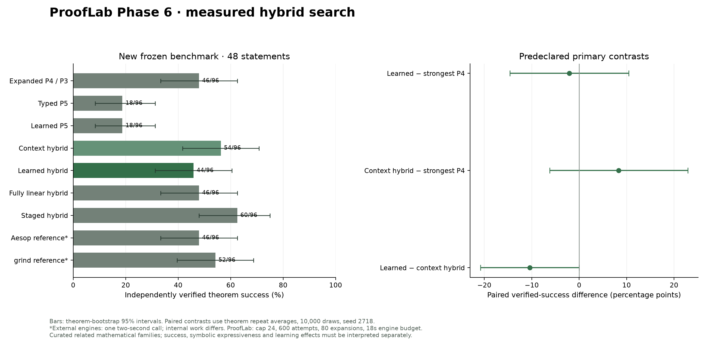
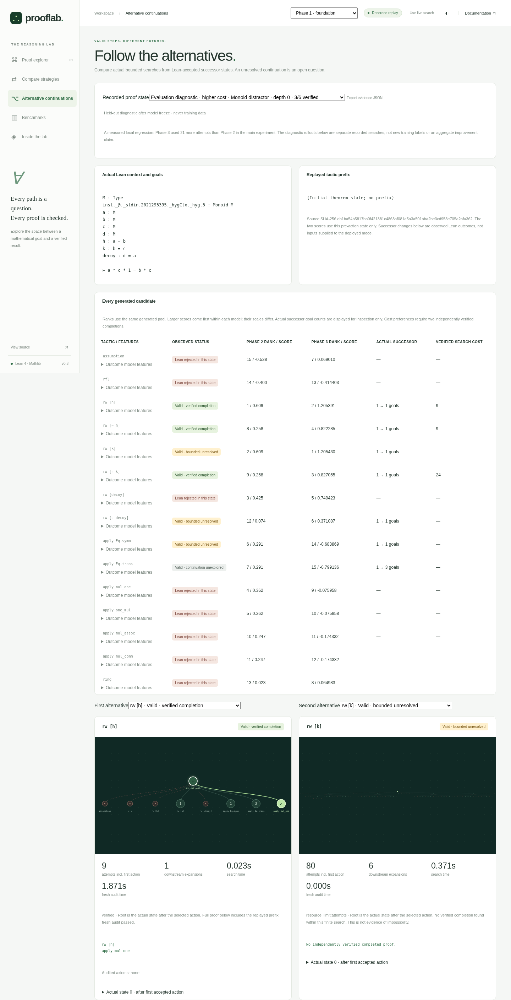
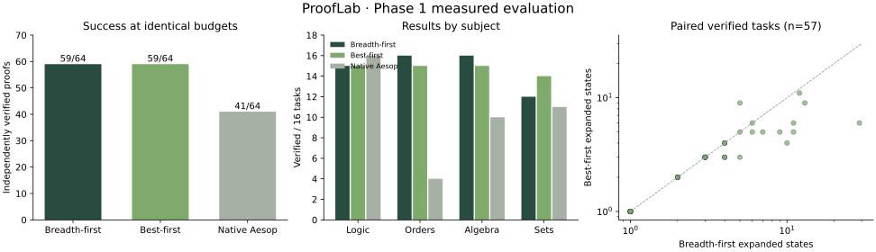
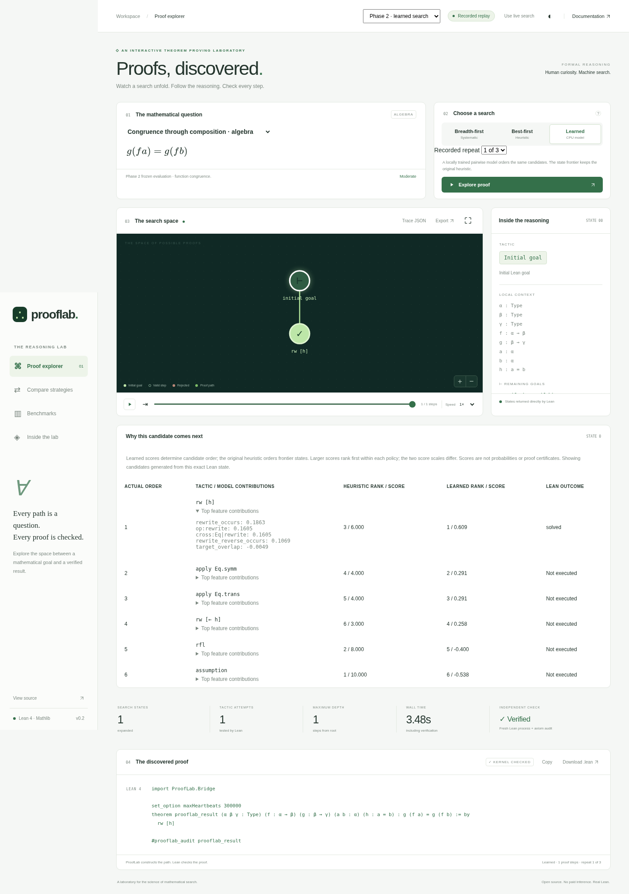

# ProofLab

### Learning to Search for Formal Mathematical Proofs

An interactive machine-learning and symbolic proof-search laboratory built on Lean 4 and
Mathlib. ProofLab **constructs proof paths** using breadth-first, handcrafted
best-first, locally learned candidate ranking and learned frontier scheduling, visualizes actual tactic attempts, and
rechecks every successful proof in a separate Lean process.

**v0.6.0 review candidate:** adaptive hybrid search combines the strongest Phase 4
symbolic generator, native type-directed retrieval, callable expression synthesis
and locally learned mathematical-context selection. The integrated **Adaptive
Proof Search Explorer** separates proposed/selected tactics, execution order,
actual Lean outcomes and independently verified proofs.

The [Phase 6 final report](docs/phase-6-final-report.md) links the
[architecture](docs/phase-6-architecture.md), [data boundary](docs/phase-6-data.md),
[local models and limitations](docs/phase-6-model.md),
[measured comparisons](docs/phase-6-results.md) and
[reproduction commands](docs/phase-6-reproduction.md).

The frozen study uses **48 new statements**, a **160-task development curriculum**
and **1440 registered searches**, with Phase 4 expanded generation and Phase 3
scheduling as its strongest prior baseline. Candidate relevance is selected on
whole-family development validation; a separate trained cost controller chooses
symbolic, typed or hybrid generation. The primary model and two controller seeds
are fixed before final testing. Search, native queries, strong automation and
independent verification remain separately inspectable.

**Measured Phase 6 finding:** expanded P4 solves **23/48**, deterministic hybrid
**27/48**, learned hybrid **22/48** and staged hybrid **30/48**, identically in
both recorded repetitions. The primary learned-minus-P4 success difference is
−2.083 percentage points (paired 95% interval −14.583 to +10.417): **no ML
improvement is established**. The staged result is descriptive; its post-hoc
theorem interval touches zero and family sensitivity crosses zero. New synthesis
adds six verified tasks over the old-construction control. All 1440 executions,
seven statements unsolved by every arm, and genuine regressions remain available.

Historical Phase 5 evidence remains unchanged: deterministic typed and learned
retrieval each solve **15/40**, the expanded Phase 4 generator **29/40**, and
separate native Aesop **31/40**, with all **1120 actual searches** retained. The
learned retriever adds no success and costs 328 extra attempts on one group task.
The [Phase 5 report](docs/phase-5-final-report.md) and earlier
[Phase 4 negative result](docs/phase-4-final-report.md) remain available; neither
is presented as a new Phase 6 test. This draft targets
`feature/phase5-type-directed-retrieval` and is not merged into `main`.

No paid model, API key, external inference service, or GPU is required.



**Explore:** [animated real trace](docs/assets/proof-search.gif) ·
[algorithm comparison](docs/assets/algorithm-comparison.png) ·
[measured results](docs/experimental-results.md) ·
[Phase 1 delivery report](docs/phase-1-final-report.md)

```lean
example (P Q R : Prop) (hpq : P → Q) (hqr : Q → R) (hp : P) : R := by
  apply hqr
  apply hpq
  assumption
```

This is a genuine search output, independently checked by Lean. The candidate
generator does not contain per-task answer scripts.

The Search Architecture Explorer replays complete actual trees, queue selections,
state/candidate scores, feature contributions, native repeated-shape diagnostics,
verified proofs and failures side by side. It has a labelled neighborhood view,
complete-tree mode, zoom/pan and full-data exports. Prior live search and replay
views remain available. The Phase 6 selector adds actual context/strategy decisions,
nominal and borrowed candidate slots, controller costs/components, real regressions,
query failures and full-call timing. Its Phase 5 experiment selector retains the integrated
Premise & Candidate Explorer: actual types, required premises, witness constructions,
compatibility, deterministic/learned retrieval scores, actual scheduler ranks,
application outcomes, displaced candidates and resource costs. Static replay,
local computation and full JSON exports are supported.
See [Phase 6 reproduction commands](docs/phase-6-reproduction.md).



## Quick start

Prerequisites: Linux, Python 3.12+, [uv](https://docs.astral.sh/uv/), Node.js
20.19+ (or 22.12+), npm, Git, curl. Allow several GB for Lean and Mathlib.

```bash
git clone --branch feature/phase6-adaptive-hybrid https://github.com/Marci99forgrateful/prooflab.git
cd prooflab
bash scripts/bootstrap.sh
uv run --frozen prooflab serve
```

Open the local address printed by the server. The app defaults to clearly
labelled **recorded replay**; choose **Use live search** to compute a new proof.
The backend binds only to the loopback interface and accepts repository-owned
task IDs, never visitor-supplied Lean code.

```bash
uv run --frozen prooflab search imp_chain --algorithm best_first --output proof.json
uv run --frozen pytest
uv run --frozen ruff check src scripts tests
uv run --frozen mypy src/prooflab
npm --prefix web test
```

## Phase 3: which valid step has the better future?

A locally trained 108-coefficient CPU model uses **155 real cost preferences**
from 199 explored Lean-accepted alternatives, including 81 comparisons of two
nonterminal successors. Only two independently verified completions with unequal
measured costs create a preference. Sixteen unresolved continuations remain
censored, not incorrect actions. No candidate lookahead is hidden in deployment.

The frozen harder benchmark has 32 statements in eight families. Across **384
actual searches**, Phase 3, Phase 2 and the handcrafted policy each solve 23/32
theorems in both repetitions; BFS solves 20/32 and native Aesop 17/32. Phase 3
uses 144.188 mean attempts versus 145.500 for Phase 2 and 144.500 for handcrafted.
**No improvement over the existing heuristic or Phase 2 is established.** A small
matched-feature ablation benefit is sensitive to family clustering; richer
features also produce a recorded regression. These findings are preserved.

```bash
uv run --frozen prooflab collect-continuations --output /tmp/prooflab-p3-data
uv run --frozen prooflab train-outcome --output /tmp/prooflab-p3-models
uv run --frozen prooflab search p3_order_guard --algorithm outcome --output /tmp/proof.json
uv run --frozen prooflab evaluate-phase3 --output experiments/phase3/my-run
uv run --frozen prooflab compact-traces --experiment experiments/phase3/my-run
```

Choose **Phase 3 · outcome learning** for five actual policy trees and scores.
Open **Alternative continuations** to inspect the complete generated pool,
accepted/rejected tactics, actual successor states, verified/censored/unexplored
futures, model contributions, exact proof paths and resource costs. Click a
continuation-tree node to inspect its native goals/context. Development evidence
and held-out post-evaluation diagnostics are explicitly distinct. Static replay,
exports and loopback-only live search remain supported.

[Model and training](docs/phase-3-model.md) ·
[Frozen data/protocol](docs/phase-3-data.md) ·
[Quantitative results and real cases](docs/phase-3-results.md) ·
[Full Phase 3 delivery report](docs/phase-3-final-report.md).



Large traces are canonical, lossless gzip JSON with original-byte hash indices;
`prooflab unpack-traces` restores them exactly. Offline web assets are generated
from canonical research into ignored files during bootstrap, avoiding another
large dataset copy in Git. The candidate generator, trusted Lean bridge,
independent verifier and all Phase 1–2 research artifacts are preserved.

## What is original?

The structural candidate generator, bounded lemma selection, search scheduling,
trace and trajectory formats, experiment runner, and interactive visualization
are project code applying established methods. Lean supplies elaboration and
kernel verification; Mathlib supplies mathematics, `ring`, and other tactics.
Native Aesop is evaluated only as a separately identified automation baseline.
The Phase 1 heuristic remains hand designed. Phase 2 separately fits a small linear model from real development-only Lean replay evidence; neither method is claimed to be novel machine-learning research.

## How the laboratory works

```text
Theorem → actual Lean goal → structural candidates → BFS / heuristic / learned ordering
                               ↑                         ↓
                        Mathlib lemma index ← saved Lean elaboration states
                                                         ↓
                              fresh Lean kernel check + transitive axiom audit
                                                         ↓
                                proof artifact · real search tree · research data
```

A persistent native Lean tactic session executes candidate steps and restores
complete elaboration snapshots between branches. Python schedules the search;
it never imitates Lean's proof semantics. The final proof is reconstructed and
rechecked in a **fresh process**, accepting only the standard Lean axioms
`propext`, `Classical.choice`, `Quot.sound`. Admitted proofs and untrusted axioms
are rejected. See [integration and trust policy](docs/lean-integration.md).

The interface supports theorem selection, algorithm choice, actual node and
local-context inspection, pause/replay/speed control, pan/zoom, responsive dark
and light themes, downloadable `.lean` artifacts, complete JSON traces and SVG
exports. All mathematical fonts and rendering assets are local. Full local
computation and static recorded replay are clearly distinguished.

## Mathematical scope

The initial 64-task benchmark includes logic, quantifiers, generic partial
orders, inequality chains, monoid/ring identities, rewriting and elementary
sets. The bounded index has 24 inspectable imported declarations. This is an
elementary mathematical fragment, not arbitrary advanced theorem proving.

One genuine multi-step output for subset monotonicity is:

```lean
example (α : Type) (A B C : Set α) (h : A ⊆ B) : A ∩ C ⊆ B ∩ C := by
  intro h0
  intro h1
  constructor
  apply h
  exact h1.1
  exact h1.2
```

The proof is a search output, not a candidate-generator template.
The exact scripts, attempts and independent audits are retained in raw traces.

## Experiments and reproducibility

[The benchmark report](docs/experimental-results.md) contains actual measurements,
failure analysis, per-subject and held-out results, source commit, exact budgets
and dataset hash. Raw JSON, CSV and learning-trajectory data are in
[`experiments/`](experiments/). Earlier pilot runs are preserved, including
failures that revealed general notation and retrieval bugs.

```bash
uv run --frozen prooflab benchmark --output experiments/my-run \
  --timeout 12 --depth 7 --expansions 60 --attempts 400 --workers 2
uv run --frozen python scripts/export_demo.py experiments/my-run
npm --prefix web run build
```

The two original searches use identical candidate sets and budgets. Native
Aesop is a separate reference. One-step lemma retrieval, specialized tactics
and constructed derivations are reported separately. A failed bounded search
never means the statement is false. The Phase 1 reserved split was **not a blinded
evaluation**. Phase 2 uses a separately frozen new-family evaluation; its model
never trains on either held-out set. No statistical breakthrough or mathematical
novelty is claimed. See [methodology](docs/benchmark-methodology.md).



## Research and development guide

| Topic | Documentation |
|---|---|
| Architecture and decisions | [Architecture](docs/architecture.md) |
| Native bridge and verification | [Lean integration](docs/lean-integration.md) |
| Original algorithms | [Search algorithms](docs/search-algorithms.md) |
| Inspectable lemma index | [Mathlib retrieval](docs/mathlib-retrieval.md) |
| Evaluation protocol | [Benchmark methodology](docs/benchmark-methodology.md) |
| Actual measured evidence | [Experimental results](docs/experimental-results.md) |
| Interaction and trace semantics | [Visualization](docs/visualization.md) |
| Local learning extension | [ML roadmap](docs/ml-roadmap.md) |
| Execution boundaries and scope | [Security and limitations](docs/security-and-limitations.md) |
| Milestones and acceptance | [Progress](docs/development-progress.md), [final report](docs/phase-1-final-report.md) |

## Phase 2: learning to guide search

The exported [73-coefficient CPU model](models/phase2/ranker.json) learns from
114 actual Lean states on 47 permitted development tasks. Verified solution
steps are positive evidence; only genuinely Lean-rejected siblings form
contrasts. Valid and unexecuted alternatives are never labeled mathematically
incorrect. L2 selection uses development validation only; the frozen evaluation
contains 24 new statements in six different whole-theorem families, audited
using native Lean expression graphs for structural duplication.

```bash
uv run --frozen prooflab collect-training --output /tmp/prooflab-training-replay
uv run --frozen prooflab train --data /tmp/prooflab-training-replay --output /tmp/prooflab-ranker.json
uv run --frozen prooflab search p2_congr_nested --algorithm learned --output learned.json
uv run --frozen prooflab evaluate-phase2 --output experiments/phase2/my-run
uv run --frozen python scripts/export_phase2.py experiments/phase2/my-run
npm --prefix web run build
```

Choose **Phase 2 · learned search** in the interface, then compare BFS, handcrafted
and learned trees or inspect both rankings and feature contributions at a real
state. Three recorded repeats are selectable. Live local searches also record
both score explanations. Scores are ordering values, never proof probabilities.
Native Aesop remains a separately identified reference in benchmark results.

[Model/features/training](docs/phase-2-model.md) ·
[Frozen splits and protocol](docs/phase-2-data.md) ·
[Measured results and error analysis](docs/phase-2-results.md) ·
[Full Phase 2 delivery report](docs/phase-2-final-report.md).



The candidate generator, Lean bridge, independent checker and axiom rules are
unchanged. The learned policy changes candidate order while retaining the
original handcrafted frontier score. Raw repetitions, failures, timings,
per-theorem results and uncertainty estimates are exported in
[`experiments/phase2/evaluation-v1/`](experiments/phase2/evaluation-v1/).
In 288 actual runs, BFS, handcrafted and learned each verify 72/72 runs;
native Aesop verifies 63/72. Learned ordering averages 10.792 attempts versus
10.625 for the handcrafted policy (paired difference +0.167, 95% theorem-cluster
bootstrap interval −0.625 to +1.083). **This experiment does not establish an
improvement over the existing heuristic.** The negative finding and local
regressions are preserved without retuning.

## Deployment and compatibility

`web/dist` is a complete static replay demo with genuine precomputed traces.
The Pages workflow is prepared; publication status and remaining repository
settings are recorded in the [delivery report](docs/phase-1-final-report.md).
A workflow file does not establish a public deployment or passing hosted CI.

Linux/POSIX execution is tested. The private FIFO transport is not currently
Windows compatible, and macOS has not been tested. The Python distribution
requires this checkout, including its Lean project, dataset and web assets.
The backend accepts finite task IDs and binds only to loopback; it is not an
arbitrary-code service or an Internet-facing Lean sandbox.

## References and attribution

- [Lean installation](https://lean-lang.org/install/) and [Lean 4 source](https://github.com/leanprover/lean4).
- [Mathlib](https://github.com/leanprover-community/mathlib4) and [declaration documentation](https://leanprover-community.github.io/mathlib4_docs/).
- Limperg & From, [Aesop: White-Box Best-First Proof Search for Lean](https://github.com/leanprover-community/aesop).
- Yang et al., [LeanDojo: Theorem Proving with Retrieval-Augmented Language Models](https://arxiv.org/abs/2306.15626), NeurIPS 2023. A research reference, not a dependency or source of benchmark answer scripts.
- Russell & Norvig, *Artificial Intelligence: A Modern Approach*, search methods.

Original source is Apache-2.0. See [dependency notices](THIRD_PARTY_NOTICES.md)
and [contributing](CONTRIBUTING.md). Phase 1 engineering was AI assisted;
formal verification and executable experiments provide the evidence.
MathVerify is a separate project and remains untouched.
