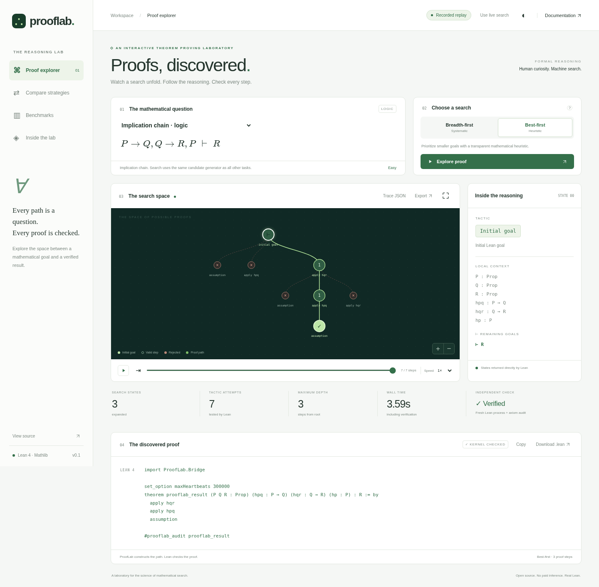

# ProofLab

### Learning to Search for Formal Mathematical Proofs

An interactive neuro-symbolic theorem proving laboratory built on Lean 4 and
Mathlib. ProofLab **constructs proof paths** using breadth-first and heuristic
best-first search, visualizes actual failed and successful tactic attempts, and
rechecks every successful proof in a separate Lean process.

No paid model, API key, external inference service, or GPU is required.



**Explore:** [animated real trace](docs/assets/proof-search.gif) ·
[algorithm comparison](docs/assets/algorithm-comparison.png) ·
[measured results](docs/experimental-results.md) ·
[Phase 1 delivery report](docs/phase-1-final-report.md)

```lean
example (P Q R : Prop) (hpq : P → Q) (hqr : Q → R) (hp : P) : R := by
  apply hqr
  apply hpq
  assumption
```

This is a genuine search output, independently checked by Lean. The candidate
generator does not contain per-task answer scripts.

## Quick start

Prerequisites: Linux, Python 3.12+, [uv](https://docs.astral.sh/uv/), Node.js
20.19+ (or 22.12+), npm, Git, curl. Allow several GB for Lean and Mathlib.

```bash
git clone https://github.com/Marci99forgrateful/prooflab.git
cd prooflab
bash scripts/bootstrap.sh
uv run --frozen prooflab serve
```

Open the local address printed by the server. The app defaults to clearly
labelled **recorded replay**; choose **Use live search** to compute a new proof.
The backend binds only to the loopback interface and accepts repository-owned
task IDs, never visitor-supplied Lean code.

```bash
uv run --frozen prooflab search imp_chain --algorithm best_first --output proof.json
uv run --frozen pytest
uv run --frozen ruff check src scripts tests
uv run --frozen mypy src/prooflab
npm --prefix web test
```

## What is original?

The structural candidate generator, bounded lemma selection, search scheduling,
trace and trajectory formats, experiment runner, and interactive visualization
are project code applying established methods. Lean supplies elaboration and
kernel verification; Mathlib supplies mathematics, `ring`, and other tactics.
Native Aesop is evaluated only as a separately identified automation baseline.
Hand-designed heuristics are not described as a trained AI model or novel research.

## How the laboratory works

```text
Theorem → actual Lean goal → structural candidates → BFS / best-first frontier
                               ↑                         ↓
                        Mathlib lemma index ← saved Lean elaboration states
                                                         ↓
                              fresh Lean kernel check + transitive axiom audit
                                                         ↓
                                proof artifact · real search tree · research data
```

A persistent native Lean tactic session executes candidate steps and restores
complete elaboration snapshots between branches. Python schedules the search;
it never imitates Lean's proof semantics. The final proof is reconstructed and
rechecked in a **fresh process**, accepting only the standard Lean axioms
`propext`, `Classical.choice`, `Quot.sound`. Admitted proofs and untrusted axioms
are rejected. See [integration and trust policy](docs/lean-integration.md).

The interface supports theorem selection, algorithm choice, actual node and
local-context inspection, pause/replay/speed control, pan/zoom, responsive dark
and light themes, downloadable `.lean` artifacts, complete JSON traces and SVG
exports. All mathematical fonts and rendering assets are local. Full local
computation and static recorded replay are clearly distinguished.

## Mathematical scope

The initial 64-task benchmark includes logic, quantifiers, generic partial
orders, inequality chains, monoid/ring identities, rewriting and elementary
sets. The bounded index has 24 inspectable imported declarations. This is an
elementary mathematical fragment, not arbitrary advanced theorem proving.

One genuine multi-step output for subset monotonicity is:

```lean
example (α : Type) (A B C : Set α) (h : A ⊆ B) : A ∩ C ⊆ B ∩ C := by
  intro h0
  intro h1
  constructor
  apply h
  exact h1.1
  exact h1.2
```

The proof is a search output, not a candidate-generator template.
The exact scripts, attempts and independent audits are retained in raw traces.

## Experiments and reproducibility

[The benchmark report](docs/experimental-results.md) contains actual measurements,
failure analysis, per-subject and held-out results, source commit, exact budgets
and dataset hash. Raw JSON, CSV and learning-trajectory data are in
[`experiments/`](experiments/). Earlier pilot runs are preserved, including
failures that revealed general notation and retrieval bugs.

```bash
uv run --frozen prooflab benchmark --output experiments/my-run \
  --timeout 12 --depth 7 --expansions 60 --attempts 400 --workers 2
uv run --frozen python scripts/export_demo.py experiments/my-run
npm --prefix web run build
```

The two original searches use identical candidate sets and budgets. Native
Aesop is a separate reference. One-step lemma retrieval, specialized tactics
and constructed derivations are reported separately. A failed bounded search
never means the statement is false. The reserved split is **not a blinded
evaluation**, no model has been trained, and no statistical breakthrough or
mathematical novelty is claimed. See [methodology](docs/benchmark-methodology.md).


## Research and development guide

| Topic | Documentation |
|---|---|
| Architecture and decisions | [Architecture](docs/architecture.md) |
| Native bridge and verification | [Lean integration](docs/lean-integration.md) |
| Original algorithms | [Search algorithms](docs/search-algorithms.md) |
| Inspectable lemma index | [Mathlib retrieval](docs/mathlib-retrieval.md) |
| Evaluation protocol | [Benchmark methodology](docs/benchmark-methodology.md) |
| Actual measured evidence | [Experimental results](docs/experimental-results.md) |
| Interaction and trace semantics | [Visualization](docs/visualization.md) |
| Local learning extension | [ML roadmap](docs/ml-roadmap.md) |
| Execution boundaries and scope | [Security and limitations](docs/security-and-limitations.md) |
| Milestones and acceptance | [Progress](docs/development-progress.md), [final report](docs/phase-1-final-report.md) |

The next research milestone is a small **locally trained** candidate ranker,
evaluated on a new unseen theorem-family split with the same candidate pool
and computational budgets. Phase 1 provides typed policy interfaces and genuine
split-labelled trajectories, not an untrained function presented as AI.

## Deployment and compatibility

`web/dist` is a complete static replay demo with genuine precomputed traces.
The Pages workflow is prepared; publication status and remaining repository
settings are recorded in the [delivery report](docs/phase-1-final-report.md).
A workflow file does not establish a public deployment or passing hosted CI.

Linux/POSIX execution is tested. The private FIFO transport is not currently
Windows compatible, and macOS has not been tested. The Python distribution
requires this checkout, including its Lean project, dataset and web assets.
The backend accepts finite task IDs and binds only to loopback; it is not an
arbitrary-code service or an Internet-facing Lean sandbox.

## References and attribution

- [Lean installation](https://lean-lang.org/install/) and [Lean 4 source](https://github.com/leanprover/lean4).
- [Mathlib](https://github.com/leanprover-community/mathlib4) and [declaration documentation](https://leanprover-community.github.io/mathlib4_docs/).
- Limperg & From, [Aesop: White-Box Best-First Proof Search for Lean](https://github.com/leanprover-community/aesop).
- Yang et al., [LeanDojo: Theorem Proving with Retrieval-Augmented Language Models](https://arxiv.org/abs/2306.15626), NeurIPS 2023. A research reference, not a dependency or source of benchmark answer scripts.
- Russell & Norvig, *Artificial Intelligence: A Modern Approach*, search methods.

Original source is Apache-2.0. See [dependency notices](THIRD_PARTY_NOTICES.md)
and [contributing](CONTRIBUTING.md). Phase 1 engineering was AI assisted;
formal verification and executable experiments provide the evidence.
MathVerify is a separate project and remains untouched.
