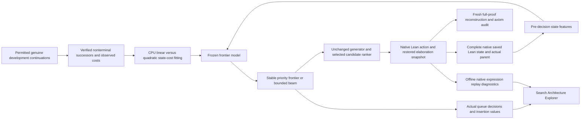
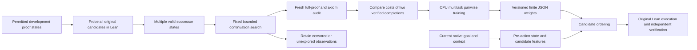
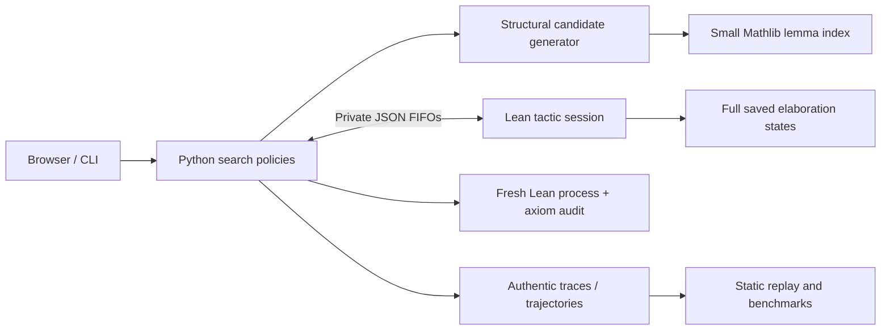

# Architecture — decision record 001

## Current Phase 4 architecture

`frontier.py` and `frontier_training.py` independently estimate the continuation
cost of expanding a complete proof state. They do not generate tactics, query
Lean during scoring, decide state equivalence or certify proofs. `search.py`
separates candidate ordering from state scheduling. The bounded beam logs every
eviction and makes no completeness claim. `state_diagnostics.py` and
`ProofLab/Inspect.lean` group native sequent shapes offline; the search never
merges these groups. Earlier protected generator, verifier and bridge hashes
remain unchanged.

The frozen benchmark/protocol precedes fitting; the selected model and execution
source precede final evaluation. [Measured results](phase-4-results.md) preserve
the frontier success regression. [Related work](phase-4-related-work.md) records
algorithm attribution, licenses and versioned source observations.

## Phase 3 dataflow (preserved foundation)

`continuations.py` retains every actually probed successor and bounded search.
`outcome_training.py` combines the original applicability contrasts with verified
valid-cost preferences, with development-family validation and two controlled
ablations. `outcome_features.py` has no native future-state access; actual
successors are offline evidence only. `OutcomeRanking` keeps the existing typed
policy interface, bounded candidate generator and handcrafted frontier score.

`phase3_evaluation.py` freezes model hashes before controlled runs. Canonical
traces use lossless gzip JSON; `research_io.py` restores byte-exact originals.
`research.py` adds explicit score annotations to actual stored states for the
interactive continuation inspector. Build-time export avoids duplicated large
research files in Git. Held-out diagnostics are separate from training and are
collected only after final model selection and primary evaluation.

See [Phase 3 model](phase-3-model.md), [data/protocol](phase-3-data.md),
[measured results](phase-3-results.md), and [delivery](phase-3-final-report.md).
The original architecture notes below remain as historical foundation.

> Phase 1 foundation document. Phase 2 implementation and current evidence:
> [model](phase-2-model.md), [frozen data/protocol](phase-2-data.md),
> [measured results](phase-2-results.md), [delivery report](phase-2-final-report.md).

**Decision:** use a persistent Lean-native tactic session, Python search and
research orchestration, and an independent static browser client.

The same `generate_candidates` function and budget schema serve both original
search algorithms. A policy may rank candidates and prioritize the frontier;
it cannot certify a theorem. Aesop is an explicitly separate reference.

The bridge imports a selected Mathlib fragment (sets, groups, rings, the ring
tactic and Aesop), rather than every Mathlib module. Lean 4.24.0 and Mathlib
`f897ebcf72cd16f89ab4577d0c826cd14afaafc7` are mutually compatible and pinned.
The committed Lake manifest pins all transitive Git revisions. Python's uv
lock and the frontend npm lock capture actual installed dependencies.

The command-line/server distribution is **checkout based**: dataset, Lean
project and web assets are resolved relative to the repository. An isolated
Python wheel without the checkout is not a supported installation.

## Trust and deployment boundaries

The browser displays data; it has no mathematical authority. The public Pages
package consists only of static replay assets. New computation is available in
a loopback-only local API and accepts finite repository-owned task IDs. The
Lean bridge is an elaborator extension, not a replacement kernel. Its search
completion signal is insufficient for success: a fresh invocation must pass.

POSIX FIFOs are the selected protocol transport because Lean's frontend
isolates command stdin/stdout. FIFO paths live in a private temporary directory,
are mode 0600, and disappear when the session closes. This is tested on Linux;
Windows needs a different transport and is not claimed supported.

## Deliberate tradeoffs

One mathematical environment is loaded per theorem session, not per candidate.
The independent final check necessarily loads it again. Raw states are kept
inside Lean; serialized descriptions are for scheduling and inspection. Search
uses conservative path identity, not a potentially unsound approximation to
semantic state equivalence. This sacrifices deduplication power and is a
documented source of repeated work.

The frontend is small modern JavaScript with local KaTeX, no framework or graph
service, and a deterministic SVG layout. The original search code uses typed
Pydantic schemas and strict Mypy. Source engineering was AI assisted; executable
test results and kernel-checked outputs are the evidence, not authorship claims.
