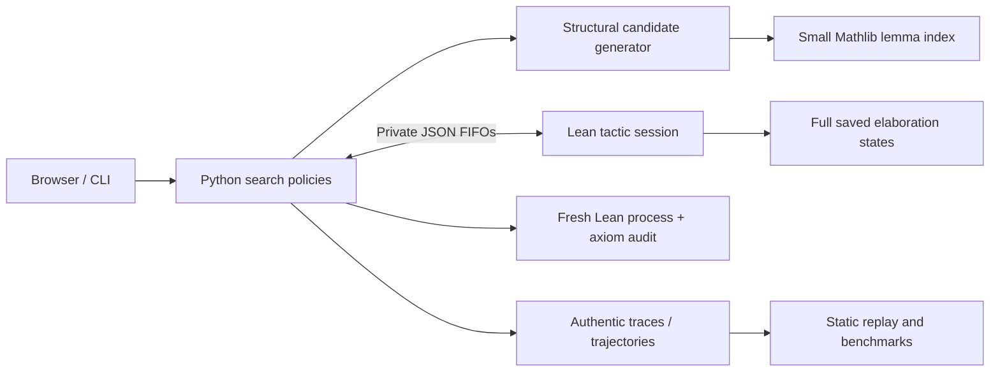

# Architecture — decision record 001

> Phase 1 foundation document. Phase 2 implementation and current evidence:
> [model](phase-2-model.md), [frozen data/protocol](phase-2-data.md),
> [measured results](phase-2-results.md), [delivery report](phase-2-final-report.md).

**Decision:** use a persistent Lean-native tactic session, Python search and
research orchestration, and an independent static browser client.

The same `generate_candidates` function and budget schema serve both original
search algorithms. A policy may rank candidates and prioritize the frontier;
it cannot certify a theorem. Aesop is an explicitly separate reference.

The bridge imports a selected Mathlib fragment (sets, groups, rings, the ring
tactic and Aesop), rather than every Mathlib module. Lean 4.24.0 and Mathlib
`f897ebcf72cd16f89ab4577d0c826cd14afaafc7` are mutually compatible and pinned.
The committed Lake manifest pins all transitive Git revisions. Python's uv
lock and the frontend npm lock capture actual installed dependencies.

The command-line/server distribution is **checkout based**: dataset, Lean
project and web assets are resolved relative to the repository. An isolated
Python wheel without the checkout is not a supported installation.

## Trust and deployment boundaries

The browser displays data; it has no mathematical authority. The public Pages
package consists only of static replay assets. New computation is available in
a loopback-only local API and accepts finite repository-owned task IDs. The
Lean bridge is an elaborator extension, not a replacement kernel. Its search
completion signal is insufficient for success: a fresh invocation must pass.

POSIX FIFOs are the selected protocol transport because Lean's frontend
isolates command stdin/stdout. FIFO paths live in a private temporary directory,
are mode 0600, and disappear when the session closes. This is tested on Linux;
Windows needs a different transport and is not claimed supported.

## Deliberate tradeoffs

One mathematical environment is loaded per theorem session, not per candidate.
The independent final check necessarily loads it again. Raw states are kept
inside Lean; serialized descriptions are for scheduling and inspection. Search
uses conservative path identity, not a potentially unsound approximation to
semantic state equivalence. This sacrifices deduplication power and is a
documented source of repeated work.

The frontend is small modern JavaScript with local KaTeX, no framework or graph
service, and a deterministic SVG layout. The original search code uses typed
Pydantic schemas and strict Mypy. Source engineering was AI assisted; executable
test results and kernel-checked outputs are the evidence, not authorship claims.
