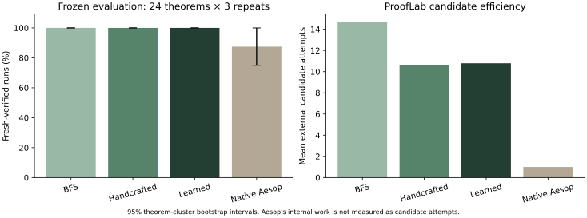

# Phase 2: actual measured results

The learned model works, but this experiment does **not establish an advantage over the handcrafted policy**. All three ProofLab policies solve all 24 evaluation theorems in every repetition. Learned ordering uses slightly more candidate attempts on average than the original heuristic; the paired interval includes both improvement and regression. The model is preserved without test-driven retuning.

## Experiment

There are 288 actual searches: 24 frozen statements × four policies × three repeats, with two workers. The learned model and runner were committed in `1b9262d` before test execution; statements/protocol were frozen in `ceb3e18` before model selection. Budgets: depth 8, 60 expanded states, 24 candidates/state, 400 attempts, 12 seconds wall time, 3 seconds/tactic. Candidate generator, Lean bridge and independent verifier remain byte-identical to v0.1.0.

[Raw JSON traces, per-run CSV, summary and provenance](../experiments/phase2/evaluation-v1/) · [model](../models/phase2/ranker.json) · [training report](../experiments/phase2-training/training-report.json) · [methodology and data limitations](phase-2-data.md).

## Aggregate observations

| Policy | Verified runs | Mean expansions | Mean attempts | Mean wall s | Mean Lean interaction s | Resource failures | Execution errors |
|---|---:|---:|---:|---:|---:|---:|---:|
| Breadth-first | 72/72 | 3.500 | 14.667 | 3.940 | 0.0328 | 0 | 0 |
| Handcrafted best-first | 72/72 | 2.667 | 10.625 | 3.934 | 0.0234 | 0 | 0 |
| Learned ordering | 72/72 | 2.708 | 10.792 | 3.923 | 0.0237 | 0 | 0 |
| Native Aesop reference | 63/72 | 1.000 | 1.000 | 3.785 | 0.0500 | 0 | 0 |

All counts include incomplete runs. Lean interaction measures external native tactic calls. Wall time also includes startup and fresh independent audit; initialization, verification, planning and model-inference distributions are separately exported in `summary.json` and `results.csv`. Aesop's single external call hides its internal search; its attempt/expansion counts are not comparable internal work units. Native Aesop's unsolved cases remain unsolved in all repeats: preimage monotonicity and difference monotonicity reject the tactic with no progress; preimage/intersection subset returns a partial state with remaining goals. None is certified as a proof.

| Policy | 95% theorem-cluster bootstrap interval for success |
|---|---|
| Breadth-first | 100.0% [100.0, 100.0] |
| Handcrafted best-first | 100.0% [100.0, 100.0] |
| Learned ordering | 100.0% [100.0, 100.0] |
| Native Aesop reference | 87.5% [75.0, 100.0] |

The [100%, 100%] bootstrap intervals are **degenerate because all sampled theorems succeeded**, not evidence of certain success on unseen mathematics. These are descriptive intervals for a tiny curated sample; theorem/family dependence and author choice limit inference. Three repeated timings do not create 72 independent theorem samples.

## Paired policy differences

Learned minus baseline, averaged over theorems (all three repeats kept together). Lower effort differences favor learned; positive success differences favor learned. Seed 1729, 10,000 theorem-cluster percentile resamples, 95% intervals. All-task and common-verified-subset results are both exported; no ProofLab failures censor the comparison against the handcrafted policy.

| Baseline | Success difference, pp [95% CI] | Attempts difference [95% CI] | Expansions difference [95% CI] | Wall s difference [95% CI] |
|---|---|---|---|---|
| Breadth-first | +0.000 [+0.000, +0.000] | -3.875 [-10.750, +0.083] | -0.792 [-2.250, +0.042] | -0.017 [-0.082, +0.049] |
| Handcrafted best-first | +0.000 [+0.000, +0.000] | +0.167 [-0.625, +1.083] | +0.042 [+0.000, +0.125] | -0.011 [-0.059, +0.037] |
| Native Aesop reference | +12.500 [+0.000, +25.000] | +9.792 [+5.875, +14.208] | +1.708 [+1.042, +2.500] | +0.138 [-0.093, +0.420] |

The timings share a host and are dominated by Lean startup and independent verification. The small wall-time differences do not establish a portable speed improvement. Success is saturated; the sample cannot show an increase above the original policy's 24/24. These findings do not justify reducing test difficulty, changing budgets or tuning against the test set.

## Per-theorem results

Every ProofLab entry is independently verified in all three repeats. Counts below are mean external attempts; they were identical across repeats for each ProofLab policy. Full per-repeat wall/Lean times, resource/error statuses, expansions and exact proofs are in the CSV and trace JSON.

| Theorem | Family | BFS attempts | Handcrafted attempts | Learned attempts | Learned − handcrafted |
|---|---|---:|---:|---:|---:|
| `p2_congr_binary` | function_congruence | 13 | 12 | 9 | -3 |
| `p2_congr_function_argument` | function_congruence | 13 | 12 | 9 | -3 |
| `p2_congr_nested` | function_congruence | 3 | 3 | 1 | -2 |
| `p2_congr_single` | function_congruence | 3 | 3 | 1 | -2 |
| `p2_difference_construct` | set_differences | 7 | 6 | 7 | +1 |
| `p2_difference_exclusion` | set_differences | 5 | 4 | 4 | +0 |
| `p2_difference_member` | set_differences | 2 | 2 | 1 | -1 |
| `p2_difference_monotone` | set_differences | 121 | 40 | 43 | +3 |
| `p2_exists_nested` | existential_elimination | 36 | 34 | 33 | -1 |
| `p2_exists_project` | existential_elimination | 17 | 15 | 14 | -1 |
| `p2_exists_swap` | existential_elimination | 17 | 24 | 23 | -1 |
| `p2_exists_transport` | existential_elimination | 13 | 13 | 13 | +0 |
| `p2_predicate_argument` | predicate_transport | 4 | 4 | 6 | +2 |
| `p2_predicate_binary` | predicate_transport | 21 | 21 | 25 | +4 |
| `p2_predicate_function` | predicate_transport | 4 | 4 | 6 | +2 |
| `p2_predicate_negative` | predicate_transport | 11 | 6 | 9 | +3 |
| `p2_preimage_inter_member` | set_preimages | 4 | 4 | 4 | +0 |
| `p2_preimage_inter_subset` | set_preimages | 18 | 8 | 14 | +6 |
| `p2_preimage_member` | set_preimages | 1 | 1 | 1 | +0 |
| `p2_preimage_monotone` | set_preimages | 7 | 7 | 7 | +0 |
| `p2_witness_augment` | witness_construction | 17 | 17 | 17 | +0 |
| `p2_witness_binary` | witness_construction | 8 | 8 | 7 | -1 |
| `p2_witness_pair` | witness_construction | 4 | 4 | 3 | -1 |
| `p2_witness_single` | witness_construction | 3 | 3 | 2 | -1 |

## Error analysis from actual rankings

- **A real local benefit:** `p2_congr_nested` proves `g (f a) = g (f b)` with `rw [h]` in both policies. The handcrafted order tries `assumption` and `rfl` first (three attempts). The learned scores put `rw [h]` first (one attempt). Repeat 1 root scores: rewrite 0.609, reflexivity −0.400, assumption −0.538. The proof and mathematical result are identical.
- **A larger local regression:** `p2_preimage_inter_subset` uses 8 attempts with the handcrafted policy and 14 with learned ordering, with the same verified `intro h0; intro h1; assumption` proof. At the final expanded goal, the learned model ranks `constructor` (0.529) and decomposition ahead of the closing `assumption` (−0.489). It tries six candidates at that state before the successful assumption, whereas the original policy tries it immediately. Lean sees definitional equality that the text-based features do not capture.
- **Predicate transport:** `p2_predicate_binary` uses 21 versus 25 attempts and the same two reverse rewrites followed by assumption. Learned scores demote `assumption` behind rewrites even when the goal has become directly available. The model's positive-only-path/invalid-contrast curriculum does not learn optimal ordering among valid alternatives. The related predicate tasks also regress.
- **Frontier consequences:** `p2_difference_monotone` uses 40 versus 43 attempts and eight versus nine expansions for the same six-step proof. Candidate ordering changes accepted-state insertion order, so stable frontier ties can change which state is expanded even though the state-priority function itself is unchanged.

These are recorded executions, not hypothetical examples: inspect matching `--best_first--r0.json` and `--learned--r0.json` files in the raw trace directory, or select these tasks in the interactive Phase 2 view. The full candidate pools, actual order, genuine Lean state, scores, outcomes and top feature products are retained. The same structural differences recur in all three repeats.

The applicability model has only 230 training contrasts and limited context encoding. State-only features, including assumption availability, cancel in pairwise differences and cannot express an action-conditioned preference. Goal-shape/action features are too coarse to model all definitional equalities or the downstream cost of valid branches. These are plausible mechanisms supported by the scores and code, not experimentally isolated causal ablations. No corrective feature or hyperparameter change was made after seeing the test outcomes.

A next study should collect broader permitted evidence, add candidate-conditioned semantic/context features and test on genuinely new unseen families. That is a proposed future experiment; this delivery claims no measured benefit for those changes.
