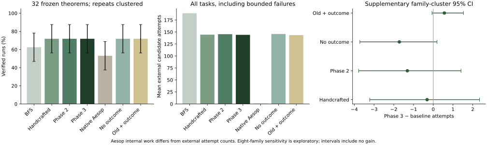

# Phase 3: measured outcome-aware proof search

The new model learns from genuine valid-alternative futures, but this experiment **does not establish an improvement over the handcrafted or Phase 2 policy**. All three solve 23/32 tasks. The matched-feature ablation shows a small attempt-count benefit from the new signal; its uncertainty crosses zero when resampling the eight theorem families instead of treating all 32 statements as independent clusters. The enhanced representation itself does not establish a benefit and contributes a concrete regression. No model or dataset is retuned after these findings.

## Controlled experiment

384 actual searches: 32 statements, five primary policies with two repetitions, and two ablations with one repetition. Counts below include failures. Repeats are execution measurements, not independent mathematical observations. Same generator and primary ProofLab budgets: depth 10, 70 expansions, 24 candidates/state, 500 attempts, 12 seconds wall time, two seconds/tactic. Native Aesop is a separate reference with its own internal search.

| Policy | Verified runs | Mean attempts | Mean expansions | Verified mean proof length | Mean wall s | Mean search s | Lean interaction s | Audit s | Resource-limited runs |
|---|---:|---:|---:|---:|---:|---:|---:|---:|---:|
| Breadth-first | 40/64 | 189.219 | 32.469 | 4.500 | 4.158 | 1.128 | 1.006 | 1.188 | 24 |
| Handcrafted | 46/64 | 144.500 | 23.812 | 5.000 | 3.909 | 0.727 | 0.632 | 1.349 | 18 |
| Phase 2 | 46/64 | 145.500 | 24.219 | 5.000 | 3.923 | 0.718 | 0.636 | 1.362 | 18 |
| Phase 3 outcome | 46/64 | 144.188 | 23.969 | 5.000 | 3.894 | 0.710 | 0.616 | 1.342 | 18 |
| Native Aesop | 34/64 | 1.000 | 1.000 | 1.000 | 3.023 | 0.108 | 0.080 | 1.066 | 0 |
| No outcome signal | 23/32 | 145.906 | 24.250 | 5.000 | 3.950 | 0.712 | 0.625 | 1.376 | 9 |
| Old features + outcomes | 23/32 | 143.625 | 23.938 | 5.000 | 3.941 | 0.698 | 0.620 | 1.378 | 9 |

There are no execution-error runs. Unsolved tasks and all resource terminations are retained. Native Aesop attempt/expansion counts denote one external call and cannot be compared with its hidden internal work. Search time is elapsed minus startup minus fresh verification, including cleanup overhead. Timings share a host; inference/explanation cost is counted for all ProofLab policies. Each individual component, min/max/median, proof length, termination and family result is exported in JSON/CSV.

## Paired differences and uncertainty

Phase 3 minus baseline; lower effort favors Phase 3. Primary intervals use the frozen 10,000-sample theorem-cluster bootstrap (seed 2718), retaining repeated executions together. They describe this curated sample under a theorem-independence assumption.

| Baseline | Success difference, pp [95% interval] | All-task attempts difference [95% interval] | Expansions difference [95% interval] | Wall s difference [95% interval] |
|---|---|---|---|---|
| Breadth-first | +9.375 [+0.000, +21.875] | -45.031 [-81.562, -13.312] | -8.500 [-15.031, -2.906] | -0.264 [-0.628, +0.017] |
| Handcrafted | +0.000 [+0.000, +0.000] | -0.312 [-2.156, +1.906] | +0.156 [-0.125, +0.594] | -0.015 [-0.136, +0.095] |
| Phase 2 | +0.000 [+0.000, +0.000] | -1.312 [-3.562, +0.906] | -0.250 [-0.688, +0.031] | -0.029 [-0.123, +0.062] |
| Native Aesop | +18.750 [+0.000, +37.500] | +143.188 [+91.125, +199.938] | +22.969 [+14.625, +32.188] | +0.871 [+0.452, +1.312] |
| No outcome signal | +0.000 [+0.000, +0.000] | -1.719 [-3.625, -0.188] | -0.281 [-0.719, +0.000] | -0.056 [-0.162, +0.050] |
| Old features + outcomes | +0.000 [+0.000, +0.000] | +0.562 [+0.000, +1.562] | +0.031 [+0.000, +0.094] | -0.047 [-0.151, +0.054] |

All-task effort can misleadingly favor a policy that stops early without proving anything. The next table restricts each comparison to theorems verified by both policies in every recorded repeat; these supplementary intervals also resample theorem clusters. Proof lengths in the aggregate table include verified runs only, so zero-length failed searches are never presented as short proofs.

| Baseline | Common verified theorems | Attempts difference [supplementary 95% interval] |
|---|---:|---|
| Breadth-first | 20 | -36.000 [-72.350, -8.300] |
| Handcrafted | 23 | -0.435 [-2.957, +2.652] |
| Phase 2 | 23 | -1.870 [-5.000, +1.348] |
| Native Aesop | 14 | +24.643 [+17.071, +32.571] |
| No outcome signal | 23 | -2.435 [-4.957, -0.348] |
| Old features + outcomes | 23 | +0.783 [+0.000, +2.174] |

### Family-cluster sensitivity

Four statements within each of eight families can be dependent. This **supplementary analysis was added after selection**, changes no model/data/budget and resamples whole frozen families (all four statements and repeats together). It is more conservative about independent mathematical units. Only eight family clusters remain, so inference is still limited.

| Baseline | All-task attempt difference [95% family-cluster interval] |
|---|---|
| Handcrafted | -0.312 [-3.219, +2.344] |
| Phase 2 | -1.312 [-3.781, +1.406] |
| No outcome signal | -1.719 [-3.719, +0.188] |
| Old features + outcomes | +0.562 [-0.062, +1.531] |

The matched-feature no-outcome ablation has a theorem-resampled interval below zero, but its family-resampled interval includes zero. This is **suggestive, small sample evidence**, not a robust general gain. The old-feature outcome model has a slightly lower mean attempt count than the full representation; adding features is not automatically an improvement. Success is unchanged across learned/heuristic variants.

## Mathematical families

Each entry counts unique theorems verified in **every** recorded repeat, out of four; repeated runs do not enlarge the family sample.

| Family | BFS | Handcrafted | Phase 2 | Phase 3 | Aesop | No outcome signal | Old features + outcomes |
|---|---:|---:|---:|---:|---:|---:|---:|
| contextual_polynomial_routes | 4/4 | 4/4 | 4/4 | 4/4 | 0/4 | 4/4 | 4/4 |
| disjunctive_routes | 4/4 | 4/4 | 4/4 | 4/4 | 4/4 | 4/4 | 4/4 |
| higher_order_routes | 4/4 | 4/4 | 4/4 | 4/4 | 4/4 | 4/4 | 4/4 |
| nested_set_routes | 1/4 | 3/4 | 3/4 | 3/4 | 1/4 | 3/4 | 3/4 |
| noncommutative_rewrite_routes | 2/4 | 2/4 | 2/4 | 2/4 | 4/4 | 2/4 | 2/4 |
| ordered_route_products | 0/4 | 1/4 | 1/4 | 1/4 | 0/4 | 1/4 | 1/4 |
| relational_diamonds | 4/4 | 4/4 | 4/4 | 4/4 | 4/4 | 4/4 | 4/4 |
| set_exclusion_routes | 1/4 | 1/4 | 1/4 | 1/4 | 0/4 | 1/4 | 1/4 |

## Every theorem, including failures

Cells show verified repetitions / recorded repetitions followed by mean candidate attempts. The canonical per-run CSV has all timing/proof/resource fields.

| Theorem | BFS | Handcrafted | Phase 2 | Phase 3 | Aesop | No outcome | Old features + outcomes |
|---|---|---|---|---|---|---|---|
| `p3_higher_cycle` | 2/2 · 58 | 2/2 · 43 | 2/2 · 44 | 2/2 · 43 | 2/2 · 1 | 1/1 · 43 | 1/1 · 44 |
| `p3_higher_discharge` | 2/2 · 11 | 2/2 · 11 | 2/2 · 11 | 2/2 · 11 | 2/2 · 1 | 1/1 · 11 | 1/1 · 11 |
| `p3_higher_nested` | 2/2 · 31 | 2/2 · 31 | 2/2 · 31 | 2/2 · 31 | 2/2 · 1 | 1/1 · 31 | 1/1 · 31 |
| `p3_higher_pair` | 2/2 · 14 | 2/2 · 14 | 2/2 · 14 | 2/2 · 14 | 2/2 · 1 | 1/1 · 14 | 1/1 · 14 |
| `p3_monoid_chain` | 2/2 · 87 | 2/2 · 59 | 2/2 · 54 | 2/2 · 59 | 2/2 · 1 | 1/1 · 54 | 1/1 · 59 |
| `p3_monoid_distractor` | 2/2 · 26 | 2/2 · 23 | 2/2 · 18 | 2/2 · 39 | 2/2 · 1 | 1/1 · 33 | 1/1 · 24 |
| `p3_monoid_reverse` | 0/2 · 500 | 0/2 · 500 | 0/2 · 500 | 0/2 · 500 | 2/2 · 1 | 0/1 · 500 | 0/1 · 500 |
| `p3_monoid_three` | 0/2 · 500 | 0/2 · 500 | 0/2 · 500 | 0/2 · 500 | 2/2 · 1 | 0/1 · 500 | 0/1 · 500 |
| `p3_or_both_long` | 2/2 · 40 | 2/2 · 28 | 2/2 · 28 | 2/2 · 28 | 2/2 · 1 | 1/1 · 28 | 1/1 · 28 |
| `p3_or_chain` | 2/2 · 23 | 2/2 · 23 | 2/2 · 18 | 2/2 · 18 | 2/2 · 1 | 1/1 · 18 | 1/1 · 18 |
| `p3_or_dead_branch` | 2/2 · 23 | 2/2 · 23 | 2/2 · 23 | 2/2 · 23 | 2/2 · 1 | 1/1 · 23 | 1/1 · 23 |
| `p3_or_pair_routes` | 2/2 · 37 | 2/2 · 29 | 2/2 · 25 | 2/2 · 25 | 2/2 · 1 | 1/1 · 25 | 1/1 · 25 |
| `p3_order_cycle_product` | 0/2 · 273 | 0/2 · 283 | 0/2 · 283 | 0/2 · 283 | 0/2 · 1 | 0/1 · 283 | 0/1 · 283 |
| `p3_order_guard` | 0/2 · 254 | 2/2 · 87 | 2/2 · 133 | 2/2 · 109 | 0/2 · 1 | 1/1 · 131 | 1/1 · 109 |
| `p3_order_routes` | 0/2 · 211 | 0/2 · 211 | 0/2 · 211 | 0/2 · 211 | 0/2 · 1 | 0/1 · 211 | 0/1 · 211 |
| `p3_order_square` | 0/2 · 281 | 0/2 · 285 | 0/2 · 285 | 0/2 · 285 | 0/2 · 1 | 0/1 · 285 | 0/1 · 285 |
| `p3_relation_fork` | 2/2 · 5 | 2/2 · 5 | 2/2 · 5 | 2/2 · 5 | 2/2 · 1 | 1/1 · 5 | 1/1 · 5 |
| `p3_relation_pair` | 2/2 · 104 | 2/2 · 18 | 2/2 · 18 | 2/2 · 18 | 2/2 · 1 | 1/1 · 18 | 1/1 · 18 |
| `p3_relation_reverse` | 2/2 · 28 | 2/2 · 40 | 2/2 · 40 | 2/2 · 40 | 2/2 · 1 | 1/1 · 40 | 1/1 · 40 |
| `p3_relation_shortcut` | 2/2 · 5 | 2/2 · 5 | 2/2 · 5 | 2/2 · 5 | 2/2 · 1 | 1/1 · 5 | 1/1 · 5 |
| `p3_ring_chain` | 2/2 · 116 | 2/2 · 75 | 2/2 · 72 | 2/2 · 66 | 0/2 · 1 | 1/1 · 72 | 1/1 · 65 |
| `p3_ring_product_pair` | 2/2 · 483 | 2/2 · 286 | 2/2 · 284 | 2/2 · 277 | 0/2 · 1 | 1/1 · 284 | 1/1 · 276 |
| `p3_ring_reverse` | 2/2 · 116 | 2/2 · 152 | 2/2 · 149 | 2/2 · 143 | 0/2 · 1 | 1/1 · 149 | 1/1 · 142 |
| `p3_ring_two_equalities` | 2/2 · 146 | 2/2 · 105 | 2/2 · 103 | 2/2 · 96 | 0/2 · 1 | 1/1 · 103 | 1/1 · 95 |
| `p3_set_choice` | 2/2 · 62 | 2/2 · 31 | 2/2 · 31 | 2/2 · 31 | 0/2 · 1 | 1/1 · 31 | 1/1 · 31 |
| `p3_set_complement_product` | 0/2 · 299 | 0/2 · 410 | 0/2 · 410 | 0/2 · 410 | 0/2 · 1 | 0/1 · 410 | 0/1 · 410 |
| `p3_set_diff_chain` | 2/2 · 338 | 2/2 · 63 | 2/2 · 71 | 2/2 · 61 | 0/2 · 1 | 1/1 · 71 | 1/1 · 61 |
| `p3_set_diff_nested` | 0/2 · 331 | 0/2 · 343 | 0/2 · 343 | 0/2 · 343 | 0/2 · 1 | 0/1 · 343 | 0/1 · 343 |
| `p3_set_excluded_join` | 0/2 · 410 | 0/2 · 368 | 0/2 · 367 | 0/2 · 368 | 0/2 · 1 | 0/1 · 367 | 0/1 · 368 |
| `p3_set_join_elimination` | 0/2 · 375 | 2/2 · 70 | 2/2 · 70 | 2/2 · 70 | 0/2 · 1 | 1/1 · 70 | 1/1 · 70 |
| `p3_set_join_product` | 0/2 · 447 | 0/2 · 427 | 0/2 · 427 | 0/2 · 427 | 2/2 · 1 | 0/1 · 427 | 0/1 · 427 |
| `p3_set_nested_left` | 0/2 · 421 | 2/2 · 76 | 2/2 · 83 | 2/2 · 75 | 0/2 · 1 | 1/1 · 84 | 1/1 · 75 |

## Actual cases and proof paths

These cases were selected for illustration **after** frozen evaluation, never used for fitting. Additional bounded rollouts replay an exact prefix in fresh Lean and retain all accepted/rejected candidates and audited completions. Their costs are separate diagnostics under the collection budget, not replacements for primary measurements. Full evidence and both model scores appear in the Alternative continuations view.

### `p3_order_guard` — lower cost

Phase 2 uses 133 attempts; Phase 3 uses 109. Verified proof lengths are 7 and 7.

Phase 2 actual tactic path:
```lean
apply lt_of_le_of_lt
assumption
apply lt_of_lt_of_le
assumption
apply le_trans
assumption
assumption
```

Phase 3 actual tactic path:
```lean
apply lt_of_le_of_lt
assumption
apply lt_of_lt_of_le
assumption
apply le_trans
assumption
assumption
```

### `p3_monoid_distractor` — higher cost

Phase 2 uses 18 attempts; Phase 3 uses 39. Verified proof lengths are 2 and 2.

Phase 2 actual tactic path:
```lean
rw [h]
apply mul_one
```

Phase 3 actual tactic path:
```lean
rw [h]
apply mul_one
```

### `p3_relation_reverse` — different verified path

Breadth-first uses 28 attempts; Phase 3 uses 40. Verified proof lengths are 4 and 5.

Breadth-first actual tactic path:
```lean
apply sym
apply tr
assumption
assumption
```

Phase 3 actual tactic path:
```lean
apply tr
apply sym
assumption
apply sym
assumption
```

### Interpretation of the recorded mechanisms

- `p3_order_guard`: both learned policies find the same seven-step verified proof, but Phase 3 makes 109 attempts instead of 133. In the diagnostic state after the first transitivity application, the frozen Phase 2 model ranks `apply le_trans` first and `assumption` third. Phase 3 ranks `assumption` first using candidate-conditioned context evidence. Under the diagnostic rollout, that branch verifies at cost 50; the alternative transitivity branch is unresolved within the smaller rollout budget. This is an illustrative trace mechanism, not an isolated causal ablation.
- `p3_monoid_distractor`: both policies ultimately use `rw [h]; apply mul_one`, but Phase 3 needs 39 attempts versus 18 for Phase 2. Its full feature representation places `rw [k]` ahead of `rw [h]`, despite near-equal displayed scores. Diagnostic `rw [h]` completes at cost 9; `rw [k]` remains unresolved under that finite diagnostic budget. The no-outcome ablation uses 33 attempts and the old-feature outcome model 24, so neither adding the signal nor the added representation guarantees improvement on this example.
- `p3_relation_reverse`: BFS finds a four-step proof in 28 attempts. The heuristic and learned scheduling select a different, five-step verified route; Phase 3 uses 40 attempts. The interface compares these actual paths and trees rather than drawing hypothetical alternatives.

Native resource-message occurrences inside tactic outcomes (separate from run termination counts) are exported in `analysis.json`. No resource-message observation in the development probe corpus is used as an invalid applicability contrast.

## What this establishes

The downstream signal is real: 155 preferences compare unequal measured costs of independently verified valid continuations, including 81 nonterminal-versus-nonterminal pairs. The matched-feature objective ablation changes learned weights and observed held-out attempt counts. This is a working outcome-aware system, not a larger applicability model relabeled as progress.

The experiment establishes no success advantage over the existing heuristic or Phase 2 model. Attempt-count effects are small and cluster-sensitive; the enhanced representation contributes a substantial local regression. Rollout-policy bias, only 36 preference-bearing development theorems, censoring, approximate textual semantics, limited generator coverage and eight curated families constrain conclusions. Unresolved mathematical tasks remain in the dataset. No weights, budgets or test tasks are changed to improve the headline.

Canonical evidence: [summary and raw traces](../experiments/phase3/evaluation-v1/), [training report](../models/phase3/training-report.json), [model](../models/phase3/outcome.json), [data/protocol](phase-3-data.md), [model methodology](phase-3-model.md).


