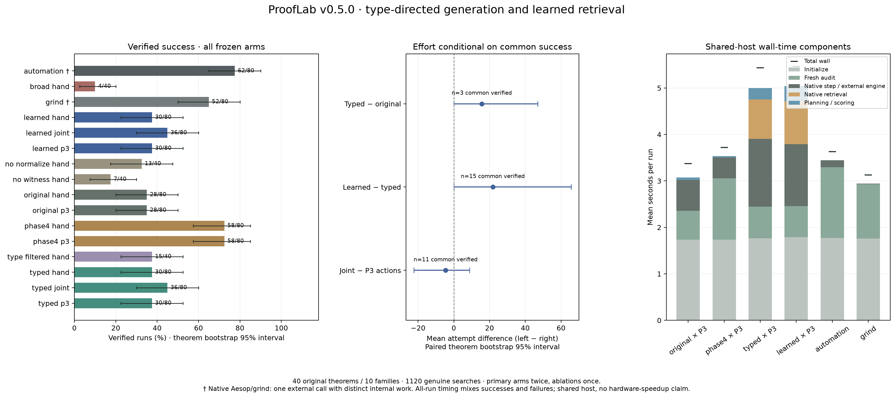

# Phase 5 experimental results

All values below derive from 1120 saved genuine searches on forty original held-out statements in ten families. Every reported success includes a fresh Lean kernel check and transitive axiom audit. No model, generator, index or budget was changed after test access.

The outer cap is 24 candidates, 600 attempts, eighty expanded states, depth twelve and eighteen seconds, with two seconds per tactic/query. Primary arms repeat twice; ablations once. Aesop/grind receive one external call with that same **two-second per-call cap**, not eighteen seconds of internal engine search. Their internal attempt/state units differ.

| Generator × scheduler | Verified runs | Success % (theorem bootstrap 95% interval) | Mean attempts | Mean expanded | Mean wall s | Mean retrieval s | Resource-limit runs | Execution errors |
|---|---:|---:|---:|---:|---:|---:|---:|---:|
| automation | 62/80 | 77.5 [65.000, 90.000] | 1 external call | internal separate | 3.627 | 0.0000 | 0 | 0 |
| broad_hand | 4/40 | 10.0 [2.500, 20.000] | 551.525 | 23.925 | 4.367 | 0.5317 | 36 | 0 |
| grind | 52/80 | 65.0 [50.000, 80.000] | 1 external call | internal separate | 3.127 | 0.0000 | 0 | 0 |
| learned_hand | 30/80 | 37.5 [22.500, 52.500] | 408.450 | 34.812 | 5.435 | 0.8914 | 50 | 0 |
| learned_joint | 36/80 | 45.0 [30.000, 60.000] | 364.375 | 27.325 | 5.637 | 1.0866 | 44 | 0 |
| learned_p3 | 30/80 | 37.5 [22.500, 52.500] | 421.775 | 35.950 | 5.464 | 0.9197 | 50 | 0 |
| no_normalize_hand | 13/40 | 32.5 [17.500, 47.500] | 431.175 | 37.050 | 4.972 | 0.9348 | 27 | 0 |
| no_witness_hand | 7/40 | 17.5 [7.500, 30.000] | 500.550 | 44.775 | 5.375 | 1.0998 | 33 | 0 |
| original_hand | 28/80 | 35.0 [20.000, 50.000] | 151.850 | 26.150 | 3.330 | 0.0000 | 22 | 0 |
| original_p3 | 28/80 | 35.0 [20.000, 50.000] | 151.875 | 26.200 | 3.372 | 0.0000 | 22 | 0 |
| phase4_hand | 58/80 | 72.5 [57.500, 85.000] | 70.800 | 9.725 | 3.759 | 0.0000 | 6 | 0 |
| phase4_p3 | 58/80 | 72.5 [57.500, 85.000] | 70.975 | 9.725 | 3.717 | 0.0000 | 6 | 0 |
| type_filtered_hand | 15/40 | 37.5 [22.500, 52.500] | 420.675 | 35.850 | 5.307 | 0.9176 | 25 | 0 |
| typed_hand | 30/80 | 37.5 [22.500, 52.500] | 412.450 | 35.325 | 5.349 | 0.8837 | 50 | 0 |
| typed_joint | 36/80 | 45.0 [30.000, 60.000] | 365.137 | 27.650 | 5.692 | 1.0456 | 44 | 0 |
| typed_p3 | 30/80 | 37.5 [22.500, 52.500] | 399.950 | 34.237 | 5.438 | 0.8450 | 50 | 0 |

All-run effort mixes verified and bounded-failure executions. A smaller attempt mean is not automatically a success/efficiency improvement. Full per-run time, native allocation counters, partial CPU/RSS measurements and proof lengths are in `results.csv` and `summary.json`. The initial regression log completed 0.350s before campaign start; its duration was not overlap. The host was shared with light engineering work. Timing is observational, not a controlled hardware speedup experiment.

A reporting-only reproducibility correction preserves the raw frozen `summary.json` and writes `summary-canonical.json`: family identifiers are sorted before the seeded bootstrap. The raw intermediate set was hash-order dependent. All run outcomes, metrics, theorem bootstrap and training/search decisions are unchanged; `statistics-correction.json` links the reports.

## Predeclared paired comparisons

Success differences use theorem averages across repetitions, with paired theorem resampling and equal-family cluster sensitivity (10,000 draws, seed 2718). Effort is also reported on the common-verified subset. When this subset has uneven family sizes, the equal-family sensitivity interval has a different point estimand; `analysis.json/family_sensitivity` records both points. It must not be interpreted as a second interval for the same theorem-weighted mean.

| Left minus right | Verified-success difference pp | Theorem interval | Family sensitivity interval | Common-verified theorems | Common-success attempts difference | Theorem interval |
|---|---:|---:|---:|---:|---:|---:|
| typed_hand minus original_hand | +2.500 | [-22.500, +25.000] | [-32.500, +40.000] | 3 | +9.333 | [-2.000, +31.000] |
| typed_p3 minus original_p3 | +2.500 | [-22.500, +25.000] | [-32.500, +40.000] | 3 | +15.667 | [+0.000, +47.000] |
| learned_hand minus typed_hand | +0.000 | [+0.000, +0.000] | [+0.000, +0.000] | 15 | +21.933 | [+0.000, +65.800] |
| learned_p3 minus typed_p3 | +0.000 | [+0.000, +0.000] | [+0.000, +0.000] | 15 | +21.867 | [+0.000, +65.600] |
| typed_joint minus typed_p3 | +7.500 | [-7.500, +22.500] | [-10.000, +25.000] | 11 | -4.545 | [-22.364, +8.727] |
| learned_joint minus learned_p3 | +7.500 | [-7.500, +22.500] | [-10.000, +25.000] | 11 | -19.727 | [-67.909, +8.727] |
| phase4_hand minus original_hand | +37.500 | [+22.500, +52.500] | [+15.000, +60.000] | 14 | -16.643 | [-48.000, +8.429] |
| typed_hand minus broad_hand | +27.500 | [+12.500, +42.500] | [+7.500, +52.500] | 3 | -21.667 | [-23.000, -21.000] |
| typed_hand minus type_filtered_hand | +0.000 | [+0.000, +0.000] | [+0.000, +0.000] | 15 | -21.933 | [-65.800, +0.000] |
| typed_hand minus no_witness_hand | +20.000 | [+7.500, +32.500] | [+2.500, +40.000] | 7 | -32.714 | [-91.857, -1.571] |
| typed_hand minus no_normalize_hand | +5.000 | [+0.000, +12.500] | [+0.000, +15.000] | 13 | +2.154 | [-16.462, +22.769] |

These are finite-benchmark estimates, not proof of general superiority. Common-success effort is conditioned on success and can change its theorem population between comparisons. Secondary contrasts are descriptive; the primary ML contrast is learned retrieval versus deterministic typed retrieval with Phase 3 scheduling.

## Actual applicability and partial useful availability

The following native-compatible acceptance ratio concerns **actually attempted** proposals with a native compatibility annotation. It excludes structure-gated normalizers and excludes resource/tool errors from its acceptance denominator. Unselected actions and selected-but-unexecuted actions have unknown outcomes. Compatibility and Lean acceptance are not downstream usefulness.

| Arm | Compatible accepted / attempted excluding errors | Compatible rejected | Incompatible but accepted | Selected actions left unexplored | Entered / displaced occurrences |
|---|---:|---:|---:|---:|---:|
| broad_hand | 7460/7460 | 0 | 3 | 907 | 20071 / 0 |
| learned_hand | 23582/23582 | 0 | 0 | 783 | 24066 / 0 |
| learned_joint | 20537/20585 | 48 | 0 | 785 | 21106 / 0 |
| learned_p3 | 24400/24400 | 0 | 0 | 782 | 24884 / 0 |
| no_normalize_hand | 12626/12626 | 0 | 0 | 362 | 12702 / 0 |
| no_witness_hand | 15104/15104 | 0 | 0 | 283 | 15262 / 0 |
| original_hand | 0/0 | 0 | 0 | 94 | 0 / 0 |
| original_p3 | 0/0 | 0 | 0 | 118 | 0 / 0 |
| phase4_hand | 0/0 | 0 | 0 | 258 | 0 / 0 |
| phase4_p3 | 0/0 | 0 | 0 | 244 | 0 / 0 |
| type_filtered_hand | 12174/12174 | 0 | 0 | 395 | 12409 / 0 |
| typed_hand | 23926/23926 | 0 | 0 | 790 | 24414 / 0 |
| typed_joint | 20528/20652 | 124 | 0 | 782 | 21229 / 0 |
| typed_p3 | 23069/23069 | 0 | 0 | 774 | 23592 / 0 |

Useful-action availability is partial witnessed recall: collect next actions from audited complete ProofLab paths, then compare capped pools only at the identical theorem and exact tactic prefix. Printed-state similarity is never used to transport a proof. The `availability` record links every matched state and actual action; `analysis.json/stratified_partial_availability` separates witnesses, normalization, broad `simp_all` and other structural/lemma actions. Strong simplifier actions must not be mistaken for learned retrieval gains. Unmatched/unexplored states have no mathematical-negative label.

## Family results

| Family | Original P3 | Expanded P3 | Typed P3 | Learned P3 | Typed joint | Aesop | grind |
|---|---:|---:|---:|---:|---:|---:|---:|
| heterogeneous_binary_congruence | 2/8 | 8/8 | 0/8 | 0/8 | 4/8 | 8/8 | 8/8 |
| heterogeneous_composition_witness | 0/8 | 2/8 | 6/8 | 6/8 | 6/8 | 8/8 | 8/8 |
| image_preimage_roundtrip | 4/8 | 6/8 | 4/8 | 4/8 | 2/8 | 6/8 | 6/8 |
| inverse_function_consequences | 2/8 | 2/8 | 2/8 | 2/8 | 0/8 | 0/8 | 4/8 |
| lattice_sandwich_constraints | 0/8 | 6/8 | 0/8 | 0/8 | 0/8 | 4/8 | 0/8 |
| noncommutative_conjugation | 0/8 | 6/8 | 6/8 | 6/8 | 4/8 | 6/8 | 0/8 |
| pointwise_set_exclusion | 8/8 | 8/8 | 2/8 | 2/8 | 4/8 | 8/8 | 8/8 |
| quantified_choice_context | 6/8 | 6/8 | 0/8 | 0/8 | 2/8 | 6/8 | 8/8 |
| relational_intermediate_witness | 6/8 | 6/8 | 2/8 | 2/8 | 6/8 | 8/8 | 8/8 |
| typed_product_construction | 0/8 | 8/8 | 8/8 | 8/8 | 8/8 | 8/8 | 2/8 |

## Per-theorem results

Entries are verified repetitions / recorded repetitions. Attempt pairs remain in the per-theorem JSON and per-run CSV, including all unsolved tasks.

| Theorem | Original P3 | Expanded P3 | Typed P3 | Learned P3 | Typed joint | Aesop | grind |
|---|---:|---:|---:|---:|---:|---:|---:|
| p5_binary_congruence | 0/2 | 2/2 | 0/2 | 0/2 | 0/2 | 2/2 | 2/2 |
| p5_binary_graph_exists | 0/2 | 2/2 | 0/2 | 0/2 | 0/2 | 2/2 | 2/2 |
| p5_binary_predicate | 0/2 | 2/2 | 0/2 | 0/2 | 2/2 | 2/2 | 2/2 |
| p5_choice_all | 0/2 | 0/2 | 0/2 | 0/2 | 0/2 | 0/2 | 2/2 |
| p5_choice_exists | 2/2 | 2/2 | 0/2 | 0/2 | 0/2 | 2/2 | 2/2 |
| p5_choice_refutation | 2/2 | 2/2 | 0/2 | 0/2 | 2/2 | 2/2 | 2/2 |
| p5_choice_shared | 2/2 | 2/2 | 0/2 | 0/2 | 0/2 | 2/2 | 2/2 |
| p5_complement_contradiction | 2/2 | 2/2 | 0/2 | 0/2 | 2/2 | 2/2 | 2/2 |
| p5_compose_conditional | 0/2 | 0/2 | 2/2 | 2/2 | 2/2 | 2/2 | 2/2 |
| p5_compose_disjunction | 0/2 | 0/2 | 0/2 | 0/2 | 0/2 | 2/2 | 2/2 |
| p5_compose_pair | 0/2 | 0/2 | 2/2 | 2/2 | 2/2 | 2/2 | 2/2 |
| p5_compose_terminal | 0/2 | 2/2 | 2/2 | 2/2 | 2/2 | 2/2 | 2/2 |
| p5_congruence_chain | 2/2 | 2/2 | 0/2 | 0/2 | 2/2 | 2/2 | 2/2 |
| p5_conjugate_cancel | 0/2 | 2/2 | 2/2 | 2/2 | 0/2 | 0/2 | 0/2 |
| p5_conjugate_context | 0/2 | 2/2 | 2/2 | 2/2 | 2/2 | 2/2 | 0/2 |
| p5_conjugate_identity | 0/2 | 2/2 | 2/2 | 2/2 | 2/2 | 2/2 | 0/2 |
| p5_exclusion_choice | 2/2 | 2/2 | 0/2 | 0/2 | 0/2 | 2/2 | 2/2 |
| p5_exclusion_disjoint | 2/2 | 2/2 | 2/2 | 2/2 | 0/2 | 2/2 | 2/2 |
| p5_exclusion_transport | 2/2 | 2/2 | 0/2 | 0/2 | 2/2 | 2/2 | 2/2 |
| p5_image_injective_back | 0/2 | 0/2 | 0/2 | 0/2 | 0/2 | 0/2 | 0/2 |
| p5_image_preimage_element | 2/2 | 2/2 | 0/2 | 0/2 | 0/2 | 2/2 | 2/2 |
| p5_image_witness | 0/2 | 2/2 | 2/2 | 2/2 | 0/2 | 2/2 | 2/2 |
| p5_inverse_equality | 0/2 | 0/2 | 0/2 | 0/2 | 0/2 | 2/2 | 0/2 |
| p5_inverse_transport | 0/2 | 0/2 | 0/2 | 0/2 | 0/2 | 0/2 | 0/2 |
| p5_inverse_unique | 0/2 | 0/2 | 0/2 | 0/2 | 0/2 | 0/2 | 2/2 |
| p5_join_upper | 0/2 | 2/2 | 0/2 | 0/2 | 0/2 | 2/2 | 0/2 |
| p5_left_inverse_injective | 2/2 | 2/2 | 0/2 | 0/2 | 0/2 | 0/2 | 2/2 |
| p5_meet_lower | 0/2 | 2/2 | 0/2 | 0/2 | 0/2 | 2/2 | 0/2 |
| p5_preimage_witness | 2/2 | 2/2 | 2/2 | 2/2 | 2/2 | 2/2 | 2/2 |
| p5_product_function | 0/2 | 2/2 | 2/2 | 2/2 | 2/2 | 2/2 | 2/2 |
| p5_product_graph | 0/2 | 2/2 | 2/2 | 2/2 | 2/2 | 2/2 | 0/2 |
| p5_product_predicate | 0/2 | 2/2 | 2/2 | 2/2 | 2/2 | 2/2 | 0/2 |
| p5_product_two_properties | 0/2 | 2/2 | 2/2 | 2/2 | 2/2 | 2/2 | 0/2 |
| p5_relation_composed | 0/2 | 0/2 | 0/2 | 0/2 | 2/2 | 2/2 | 2/2 |
| p5_relation_diagonal | 2/2 | 2/2 | 0/2 | 0/2 | 0/2 | 2/2 | 2/2 |
| p5_relation_middle | 2/2 | 2/2 | 2/2 | 2/2 | 2/2 | 2/2 | 2/2 |
| p5_relation_reverse_middle | 2/2 | 2/2 | 0/2 | 0/2 | 2/2 | 2/2 | 2/2 |
| p5_right_inverse_witness | 0/2 | 0/2 | 2/2 | 2/2 | 0/2 | 0/2 | 0/2 |
| p5_sandwich_eq | 0/2 | 0/2 | 0/2 | 0/2 | 0/2 | 0/2 | 0/2 |
| p5_two_sided_lattice | 0/2 | 2/2 | 0/2 | 0/2 | 0/2 | 0/2 | 0/2 |

## Repetition, resources and provenance

There are **8** task/arm pairs with a repeated-run difference in success, termination, proof, attempt count or expanded states. The exact disagreements and trace hashes are retained in `analysis.json`; wall-time differences alone are not counted as structural disagreements.

Matched native error-message term counts: `{"heartbeat": 0, "memory": 0, "recursion": 0, "timeout": 0}`. Outer resource limits are separately counted above; a resource limit is neither a mathematical counterexample nor automatically a code failure.

Canonical archive: 1120 exact JSON traces; 4.663 GB uncompressed / 201.366 MB retained gzip. Raw and compressed SHA-256 hashes are indexed. Static export reuses gzip archives rather than duplicating gigabytes of unpacked JSON.

Execution freeze source commit `2e1be4e437d748b6e37a58d9f64272a28ce72b97`; test runner commit is in `provenance.json`. Lean 4.24.0, Mathlib `f897ebcf72cd16f89ab4577d0c826cd14afaafc7`. Model, index, dataset, protocol, old policy artifacts and executable sources are hash-addressed. Earlier Phase 1–4 evidence is unchanged.

Live session-tree CPU plus coordinator CPU are partial resource accounting; fresh verifier CPU/RSS and post-run serialization are excluded. Summed process high-water RSS is a bound, not simultaneous peak physical memory. Allocation heartbeats are resource proxies, never primitive inference counts. See the reproducibility document for measurement scopes and limitations.

[Standalone SVG](assets/phase5-results.svg) · [PDF](assets/phase5-results.pdf) · [Canonical statistics](../experiments/phase5/evaluation-v1/summary-canonical.json) · [Raw frozen summary](../experiments/phase5/evaluation-v1/summary.json) · [Analysis](../experiments/phase5/evaluation-v1/analysis.json) · [Per-run CSV](../experiments/phase5/evaluation-v1/results.csv)
