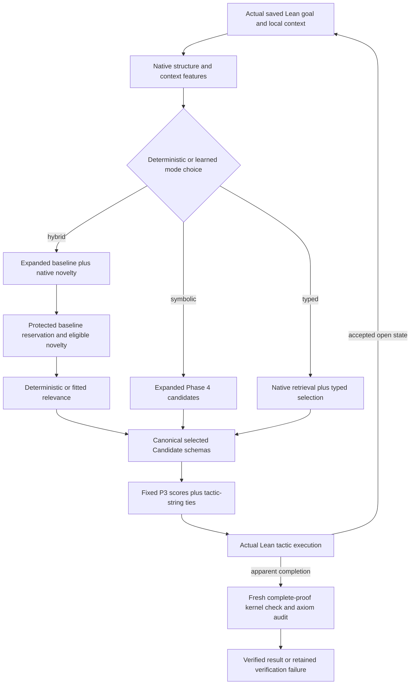

# Adaptive hybrid proof search

The new algorithm is a single resource-bounded search over genuine Lean states. It combines the strongest existing expanded symbolic generator, native typed retrieval and structured expression synthesis, with explicit allocation and optional learned expert selection. The underlying Phase 3 action scorer and handcrafted state priority remain fixed to isolate these interventions. No engine is restarted with a free fallback budget.

## Selection and execution order are separate

The old retriever sorted novelty before calling a stable action sorter. That silently changed downstream order even when membership and action scores were identical. Phase 6 makes the rule explicit: a selected tactic receives one canonical Candidate schema across new modes, then P3 score and tactic-string ties determine execution order. The retrieval score selects novelty; it does not break action-score ties. Historical baselines keep their original behavior, and a separate canonical-tie baseline measures this change.

All primary arms retain the 24-candidate cap. Hybrid selection reserves normally twenty expanded-baseline places and four novelty places; existential goals reserve sixteen/eight. Goal/specialized baseline actions are protected first. These are **reservations**: if the baseline has fewer actions, eligible novelty can borrow its unused capacity. If novelty is scarce, more baseline actions survive. Entered/displaced actions and actual counts are recorded at each expanded state. Membership protection does not guarantee that a fixed global search budget preserves every previously solvable theorem.

Eligible hybrid novelty requires native compatibility, no unresolved explicit-data guess and no generic projection/elimination proposal from the explicit exclusion list. A compatible lemma can still introduce unproductive obligations or fail when executed. Typed mode retains its separately recorded deterministic typed selection. The naive control concatenates baseline then typed candidates before truncation; a saturated baseline can leave zero new entries. It is an intentionally transparent concatenation control, not a guarantee of a balanced mixed pool.

The fixed-quota ablation shares the deterministic mathematical-context gate and always reserves four novelty places. The staged policy immediately retrieves for existential goals, gives the first two non-existential expansions the symbolic set, then uses the context gate. Its non-existential counter is distinct from its overall expansion counter. All actions and queries consume one continuous engine budget.

## Native mathematical construction

`ProofLab.Adaptive` imports the unchanged retrieval module and constructs expressions using Lean's own inferred types/elaboration. Original local terms and closed typed subexpressions of local hypothesis types seed a bounded bank. Function-valued partial applications re-enter the callable bank, enabling `f a b`, returned functions and bounded compositions. A type-directed product closure builds nested heterogeneous pairs. Explicit `Set.image`/`Set.preimage` constructors produce set-valued witnesses when their native types match the existential carrier. Every returned witness retains its actual inferred type, construction/parent description, depth and expression/type node counts.

The limits are depth three, at most 24 original local seeds, 64 bank terms, 24 data-producing functions per stage, 96 application/constructor attempts and at most 128 attempts including products. New constructions have expression/type node limits 64/96. Existing local types are context observations rather than invented constructions. Predicates are not enumerated as ordinary data-producing functions. Products are deduplicated, and literal insertion respects the bank cap. The whole query restores the saved tactic state.

This is incomplete bounded synthesis. It does not enumerate arbitrary lambda programs, arbitrary logical equivalents, unbounded curried arities or every dependent construction. Set witnesses were independently feature-tested; their presence does not establish a held-out benchmark gain. Full native declaration retrieval still uses the reproducible 116-declaration Phase 5 index rather than importing all Mathlib.

## Modes and controls

| Mode | Candidate choice | Action order / role |
|---|---|---|
| phase4 | Original expanded symbolic generator | Original P3 stable ties; primary strongest baseline |
| typed5 / learned5 | Original Phase 5 generation/weights/engine | Original P3 stable ties; historical method controls on new tasks |
| naive | Baseline-first union/truncation with typed proposals | Explicit canonical P3 ties |
| deterministic | Mathematical-context gate, protected work-conserving allocation | Canonical P3; no fitted selector/relevance |
| learned | Fitted fixed-mode cost estimates, selected candidate relevance in hybrid mode | Canonical P3; primary seed zero |
| linear | Same selected linear relevance, ridge linear mode controller | Fully linear adaptive reference |
| applicability | Acceptance-only relevance, selected primary controller | Objective ablation |
| staged / fixed | Staged context gate / fixed four-place reserve | No-learning controls |
| no_synthesis | New deterministic allocation with old native construction engine | Expression-synthesis ablation |
| phase4_canonical | Same expanded symbolic set | Explicit tie intervention alone |
| Aesop / grind | One labelled native reference call | Internal inference/queue opaque; not hidden in ProofLab |

The stochastic controller's seeds one/two are separately registered sensitivity arms, not choices selected by final performance. Primary and smaller-budget variants use the same algorithms with explicitly different fixed caps. The interface exposes actual execution and policy metadata, not an invented common tree.

## Verification, resource measurement and storage

The original Bridge, `lean.py`, candidate generator and frozen previous models remain unchanged. A native accepted transition or empty visible goal list is insufficient: every complete proof must pass a fresh Lean process and transitive axiom audit. The development corpus contains three genuine apparent closures rejected by that boundary; they remain unknown tool outcomes.

New session subclasses meter **every attempted retrieval round trip**, including failures and timeouts. They retain native probe/heartbeat counters when returned; interrupted unavailable counters remain unknown. Native heartbeats measure allocations, not primitive inference nodes. Existing engine `elapsed_s` includes its session initialization, scoring, retrieval, steps, independent verification and cleanup. Fixed artifact/provider setup precedes the engine deadline, while final metadata is assembled after engine cleanup; `artifact_setup_s` and full-call `runner_wall_s` expose this overhead. Archive serialization/interpreter startup are outside the solver-call metric. All comparable arms use the same engine deadline, with no tactic/query/branch executed outside it.

Coordinator CPU covers the complete solver-call thread. Linux live-session CPU and summed process RSS high-water bounds remain partial: independent-audit CPU/RSS and a simultaneous physical-memory peak are unavailable. Completed per-run timings, failures and limits stay inspectable; these categories overlap and must not be added as disjoint wall components.

Canonical traces are compressed once with lossless gzip and indexed by raw/compressed SHA-256. Static export copies those exact gzip files rather than committing another unpacked dataset. The integrated Adaptive Proof Search Explorer shows goals/context, recognized structures, proposals/witnesses, policy/cost estimates, allocation, retrieval/action ranks, real acceptance, complete audited paths, failed queries and actual resource costs. Old Phase 1–5 views remain available.
