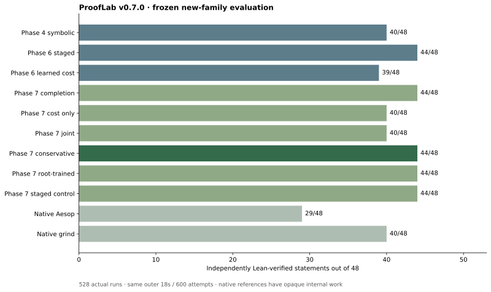
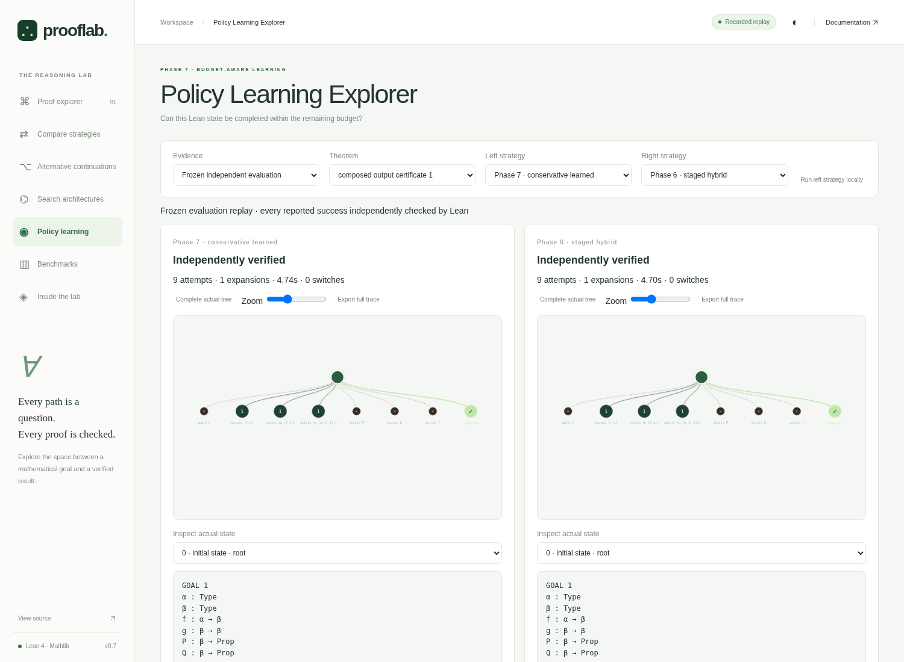
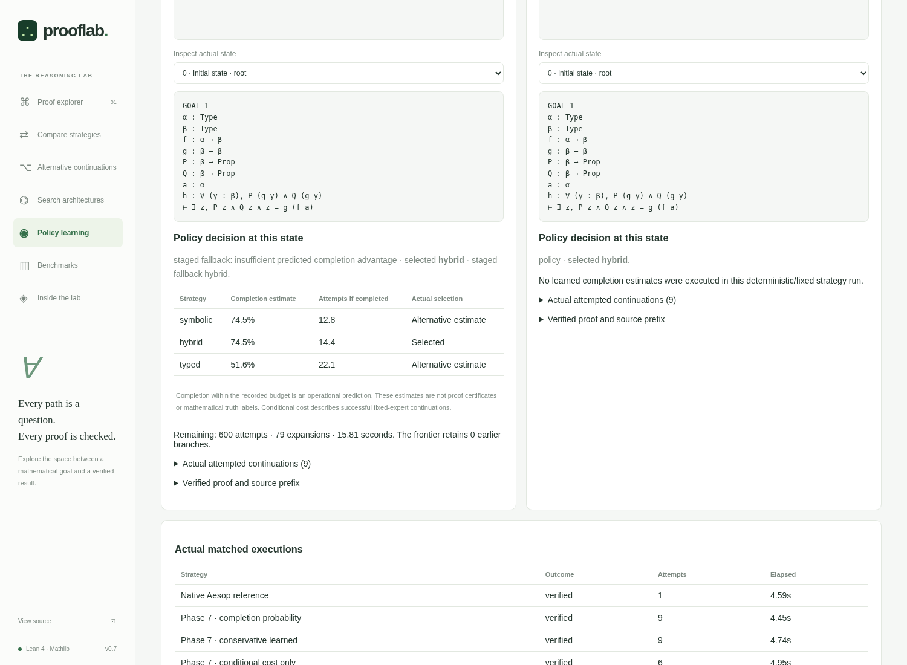

# ProofLab v0.7.0 — Budget-Aware Policy Learning

No robust improvement over the strongest prior staged algorithm is established by this registered experiment.

This is an implemented CPU learning/search study with native Lean continuations, frozen new mathematical evaluation, preserved negative outcomes and an integrated Policy Learning Explorer. It is a review candidate based on Phase 6 commit `a8af9eb8698819d07bb10f7f1bacd855f9b1213a`; no automatic merge, MathVerify change, paid AI service or GPU is part of the work.

## What changed

A trained completion classifier now learns whether a fixed expert independently finishes a proof within a stated resource budget. A separate success-conditional cost regressor estimates attempts on successful continuations. Completion-only, cost-only, joint and conservative policies share an explicitly metered native frontier. The conservative policy must earn a development-selected probability margin before leaving the deterministic staged fallback. A root-trained ablation and staged engine control separate learning/data effects from the runner.

The previous Phase 6 sources, models and all original research artifacts remain byte-identical. Reading the original repeat-zero traces reproduces 22/48 for its conditional-cost learner and 30/48 for staged hybrid. Those are a different historical dataset: the table below measures every prior algorithm afresh on the new 48 statements. Historical evaluation supplies diagnosis only, never new training labels.

## Data and executable boundaries

The frozen input has 64 development statements in sixteen families and 48 new evaluation statements in twelve families. Thirty-two development statements are explicitly recollected from permitted Phase 6 development; thirty-two are new. Native typed-expression graph checks elaborate every statement and reject alpha/binder-permutation duplicates against historical data and across the new split. Four whole development families are validation-only. The evaluation data/protocol were committed before model selection; exact models/execution were frozen before any final search.

The recorded collection contains **684 actual matched continuation runs** plus 64 staged source searches: 477 independently verified completions, 207 observed bounded noncompletions and 0 missing/error labels. Root and available intermediate states are restored by actual tactic-prefix replay. Every expert receives the same registered budget at a source state; source selection does not require source success.

Training uses 510 rows, including 222 intermediate-state rows; validation uses 174. Validation does not fit parameters. Missing and unrun alternatives are never zeros; zero is a finite operational completion event, never a mathematically false statement. Every positive label requires a fresh-process Lean kernel and transitive-axiom audit of the original theorem with full prefix and suffix.

Input freeze: `146f27a8bacf83fe069243685cd51c488d05298962a0c718e67c3e4935573b5e`. Execution freeze: `de474be1159ffe0c0c52726b717626dc5e07cad6d4e06b1a57ae2f44c75d6c40`. Collection source commit: `57a35f959ea4fb7f5631c2281d264ee9d8b946b5`. Execution source commit: `c08f523ab83215b2ad8611b5850391c98efa9325`. Canonical trace/model/source hashes are retained in their manifests. This is locally recorded preregistration, not an externally blinded evaluation.

## CPU models and development-only selection

| Architecture | Family-mean validation completion Brier | Successful validation log-cost MSE |
|---|---:|---:|
| linear | 0.172733 | 2.479995 |
| boosted | 0.160946 | 2.565006 |

Selected completion: **boosted**. Selected cost: **linear**. Conservative completion margin: **0.3**. The linear logistic model and bounded depth-two booster are both fitted and compared; inference is standard-library scalar arithmetic. The successful log-cost fit receives a training-only Duan smearing correction, recorded before model selection. The final conditional-attempt validation MAE is 58.455.

The selected-model fit takes 1.309 seconds wall / 1.309 seconds process CPU; trainer-process high-water RSS is 60532 KiB. Data collection is separate and much more expensive. Native session CPU/RSS and heartbeats are partial process observations, not a complete aggregate bill.

The joint score is `p - 0.25*p*min(conditional_attempts/remaining_attempts,2)`. Features contain native goal/context structure and remaining attempts/expansions/time, with no task/state IDs, answer scripts, future outcome or unmetered lookahead. At each expansion, the current state and resource remainder can change the chosen expert; earlier frontier branches survive switching.

## Independent new mathematical evaluation

**528 actual runs: 48 theorems × 11 arms**, one registered repetition per arm, two workers. The common engine budget is 18 seconds, 600 attempts, eighty expansions, depth twelve and cap 24; tactic/query calls are capped at two seconds. Initialization, retrieval, predictions and fresh verification consume the engine wall budget. The preserved historical wrapper has small fixed artifact setup outside that clock, while Phase 7 includes model setup; complete `runner_wall_s` is retained per run, so no identical setup-clock scope is claimed. Aesop/grind are separately identified opaque references; their single external attempt is not equal to one primitive inference or one ProofLab attempt.



| Method | Verified / 48 | Mean attempts (all runs) | Mean expanded states | Mean engine wall seconds | Mean strategy switches | Errors |
|---|---:|---:|---:|---:|---:|---:|
| Phase 4 symbolic | 40/48 | 74.33 | 9.81 | 5.144 | 0.00 | 0 |
| Phase 6 staged | 44/48 | 60.60 | 9.71 | 5.235 | 3.60 | 0 |
| Phase 6 learned cost | 39/48 | 142.23 | 24.83 | 6.033 | 0.56 | 0 |
| Phase 7 completion | 44/48 | 60.60 | 9.71 | 5.096 | 3.60 | 0 |
| Phase 7 cost only | 40/48 | 89.94 | 12.23 | 5.187 | 0.33 | 0 |
| Phase 7 joint | 40/48 | 89.94 | 12.23 | 5.163 | 0.38 | 0 |
| Phase 7 conservative | 44/48 | 60.60 | 9.71 | 5.192 | 3.60 | 0 |
| Phase 7 root-trained | 44/48 | 60.60 | 9.71 | 5.243 | 3.60 | 0 |
| Phase 7 staged control | 44/48 | 60.60 | 9.71 | 5.160 | 3.60 | 0 |
| Native Aesop | 29/48 | 1.00 | 1.00 | 3.923 | 0.00 | 0 |
| Native grind | 40/48 | 1.00 | 1.00 | 4.290 | 0.00 | 0 |

Attempts are not compared as a primitive cost against native automation. Low all-run effort can reflect early failure. Common-success effort is therefore reported separately below. Every final success retains an audited source hash, exact reconstructed proof path and complete native tree; bounded failures, query errors, timeouts and regressions remain in `results.csv` and the canonical gzip archives.

| Contrast | Success difference (pp) | Paired theorem 95% interval (pp) | Family sensitivity interval (pp) | Gains / regressions | Common-verified attempt difference |
|---|---:|---:|---:|---:|---:|
| conservative minus phase6_staged | 0.00 | [0.00, 0.00] | [0.00, 0.00] | 0 / 0 | 0.00 (44 tasks) |
| joint minus phase6_staged | -8.33 | [-18.75, 2.08] | [-29.17, 6.25] | 2 / 6 | 12.42 (38 tasks) |
| completion minus phase6_staged | 0.00 | [0.00, 0.00] | [0.00, 0.00] | 0 / 0 | 0.00 (44 tasks) |
| conservative minus staged | 0.00 | [0.00, 0.00] | [0.00, 0.00] | 0 / 0 | 0.00 (44 tasks) |
| conservative minus root_trained | 0.00 | [0.00, 0.00] | [0.00, 0.00] | 0 / 0 | 0.00 (44 tasks) |
| joint minus cost | 0.00 | [0.00, 0.00] | [0.00, 0.00] | 0 / 0 | 0.00 (40 tasks) |

### Did the learned decision change actual search?

| Policy | Decisions | Departures from staged | Changed pools at shared prefixes | Identical full action sequences / 48 |
|---|---:|---:|---:|---:|
| Phase 7 completion | 466 | 0 | 0 | 48/48 |
| Phase 7 cost only | 587 | 535 | 85 | 10/48 |
| Phase 7 joint | 587 | 533 | 85 | 10/48 |
| Phase 7 conservative | 466 | 0 | 0 | 48/48 |
| Phase 7 root-trained | 466 | 0 | 0 | 48/48 |

A fitted coefficient or probability difference is not evidence of a downstream algorithmic contribution. Identical action sequences or nonbinding guards provide no measured learning benefit. These controls are reported even when they defeat the intended learning hypothesis.

No robust improvement over the strongest prior staged algorithm is established by this registered experiment.

Intervals use 10,000 paired theorem bootstrap samples, seed 707, with separate equal-family sensitivity. Secondary contrasts are descriptive, not multiplicity-adjusted significance claims. One repetition and twelve families limit timing stability and mathematical generalization. No threshold, model or generator was retuned after these results.

## Observed mathematical continuations and regressions

### `p7_test_preimage_boolean_transport_02`: joint versus phase6_staged

The recorded outcomes are **verified / not_found_within_budget**, with 195 / 406 attempts and terminations `verified` / `resource_limit:expansions`.

At exact shared prefix `('intro h0', 'intro h1')`, the executed choices are `symbolic` / `hybrid`. The new decision record says: maximum development-trained joint decision score. Predicted fixed-expert outcomes: `{"hybrid": {"completion_probability": 0.6757062669460346, "conditional_attempts": 17.40022019153066}, "symbolic": {"completion_probability": 0.6757062669460346, "conditional_attempts": 13.097185379009467}, "typed": {"completion_probability": 0.24811051567906994, "conditional_attempts": 27.386567781872635}}`.

These are post-evaluation illustrations, not training labels or a causal guarantee. Unexpanded proof prefixes have unknown availability; an accepted or retained first action does not establish that its branch receives enough subsequent budget.
### `p7_test_lattice_guard_export_03`: joint versus phase6_staged

The recorded outcomes are **verified / not_found_within_budget**, with 234 / 600 attempts and terminations `verified` / `resource_limit:attempts`.

At exact shared prefix `('simp_all', 'rcases h with ⟨h0, h1⟩')`, the executed choices are `symbolic` / `hybrid`. The new decision record says: maximum development-trained joint decision score. Predicted fixed-expert outcomes: `{"hybrid": {"completion_probability": 0.7309054640265021, "conditional_attempts": 19.097061006156494}, "symbolic": {"completion_probability": 0.7309054640265021, "conditional_attempts": 18.399004164808616}, "typed": {"completion_probability": 0.3066581082862419, "conditional_attempts": 30.97115142904835}}`.

These are post-evaluation illustrations, not training labels or a causal guarantee. Unexpanded proof prefixes have unknown availability; an accepted or retained first action does not establish that its branch receives enough subsequent budget.
### `p7_test_image_preimage_roundtrip_01`: joint versus phase6_staged

The recorded outcomes are **not_found_within_budget / verified**, with 600 / 21 attempts and terminations `resource_limit:attempts` / `verified`.

At exact shared prefix `('intro h0', 'intro h1')`, the executed choices are `symbolic` / `hybrid`. The new decision record says: maximum development-trained joint decision score. Predicted fixed-expert outcomes: `{"hybrid": {"completion_probability": 0.7039342398717752, "conditional_attempts": 13.655715836653833}, "symbolic": {"completion_probability": 0.7039342398717752, "conditional_attempts": 9.318561816486934}, "typed": {"completion_probability": 0.46682396971863965, "conditional_attempts": 19.41944101692637}}`.

Independently checked comparison proof:

```lean
intro h0
intro h1
exists (h0)
```

These are post-evaluation illustrations, not training labels or a causal guarantee. Unexpanded proof prefixes have unknown availability; an accepted or retained first action does not establish that its branch receives enough subsequent budget.
### `p7_test_image_preimage_roundtrip_02`: joint versus phase6_staged

The recorded outcomes are **not_found_within_budget / verified**, with 600 / 19 attempts and terminations `resource_limit:attempts` / `verified`.

At exact shared prefix `('intro h0', 'intro h1')`, the executed choices are `symbolic` / `hybrid`. The new decision record says: maximum development-trained joint decision score. Predicted fixed-expert outcomes: `{"hybrid": {"completion_probability": 0.7039342398717752, "conditional_attempts": 13.656451237889137}, "symbolic": {"completion_probability": 0.7039342398717752, "conditional_attempts": 9.318383121541984}, "typed": {"completion_probability": 0.471659782010471, "conditional_attempts": 19.406611435101034}}`.

Independently checked comparison proof:

```lean
intro h0
intro h1
exists (h0)
```

These are post-evaluation illustrations, not training labels or a causal guarantee. Unexpanded proof prefixes have unknown availability; an accepted or retained first action does not establish that its branch receives enough subsequent budget.
### `p7_test_set_conjunction_witness_02`: joint versus phase6_staged

The recorded outcomes are **not_found_within_budget / verified**, with 67 / 52 attempts and terminations `search_exhausted` / `verified`.

At exact shared prefix `()`, the executed choices are `symbolic` / `hybrid`. The new decision record says: maximum development-trained joint decision score. Predicted fixed-expert outcomes: `{"hybrid": {"completion_probability": 0.745181458250919, "conditional_attempts": 13.223452256258028}, "symbolic": {"completion_probability": 0.745181458250919, "conditional_attempts": 9.055129188852252}, "typed": {"completion_probability": 0.526037858982488, "conditional_attempts": 18.96696990014263}}`.

Independently checked comparison proof:

```lean
exists (x)
simp_all
```

These are post-evaluation illustrations, not training labels or a causal guarantee. Unexpanded proof prefixes have unknown availability; an accepted or retained first action does not establish that its branch receives enough subsequent budget.
### `p7_test_image_preimage_roundtrip_03`: joint versus phase6_staged

The recorded outcomes are **not_found_within_budget / verified**, with 600 / 19 attempts and terminations `resource_limit:attempts` / `verified`.

At exact shared prefix `('intro h0', 'intro h1')`, the executed choices are `symbolic` / `hybrid`. The new decision record says: maximum development-trained joint decision score. Predicted fixed-expert outcomes: `{"hybrid": {"completion_probability": 0.7039342398717752, "conditional_attempts": 13.652927868424674}, "symbolic": {"completion_probability": 0.7039342398717752, "conditional_attempts": 9.316262193651724}, "typed": {"completion_probability": 0.471659782010471, "conditional_attempts": 19.41652577600185}}`.

Independently checked comparison proof:

```lean
intro h0
intro h1
exists (h0)
```

These are post-evaluation illustrations, not training labels or a causal guarantee. Unexpanded proof prefixes have unknown availability; an accepted or retained first action does not establish that its branch receives enough subsequent budget.
### `p7_test_image_preimage_roundtrip_04`: joint versus phase6_staged

The recorded outcomes are **not_found_within_budget / verified**, with 600 / 19 attempts and terminations `resource_limit:attempts` / `verified`.

At exact shared prefix `('intro h0', 'intro h1')`, the executed choices are `symbolic` / `hybrid`. The new decision record says: maximum development-trained joint decision score. Predicted fixed-expert outcomes: `{"hybrid": {"completion_probability": 0.7039342398717752, "conditional_attempts": 13.64630697723573}, "symbolic": {"completion_probability": 0.7039342398717752, "conditional_attempts": 9.311439462382396}, "typed": {"completion_probability": 0.471659782010471, "conditional_attempts": 19.374790961587834}}`.

Independently checked comparison proof:

```lean
intro h0
intro h1
exists (h0)
```

These are post-evaluation illustrations, not training labels or a causal guarantee. Unexpanded proof prefixes have unknown availability; an accepted or retained first action does not establish that its branch receives enough subsequent budget.
### `p7_test_set_conjunction_witness_04`: joint versus phase6_staged

The recorded outcomes are **not_found_within_budget / verified**, with 86 / 130 attempts and terminations `search_exhausted` / `verified`.

At exact shared prefix `()`, the executed choices are `symbolic` / `hybrid`. The new decision record says: maximum development-trained joint decision score. Predicted fixed-expert outcomes: `{"hybrid": {"completion_probability": 0.745181458250919, "conditional_attempts": 13.219344538418822}, "symbolic": {"completion_probability": 0.745181458250919, "conditional_attempts": 9.052124759785762}, "typed": {"completion_probability": 0.526037858982488, "conditional_attempts": 18.940873917785016}}`.

Independently checked comparison proof:

```lean
exists (x)
simp_all
```

These are post-evaluation illustrations, not training labels or a causal guarantee. Unexpanded proof prefixes have unknown availability; an accepted or retained first action does not establish that its branch receives enough subsequent budget.

All gain/regression cases and exact shared-prefix decisions are retained in `analysis.json`, including witnessed proof-path availability. The analysis does not infer outcomes of unsearched alternatives. Validation-only completion reliability bins and conditional-cost errors are also retained; adaptive final policy outcomes are not misused as calibration labels for unexecuted fixed experts.

## Policy Learning Explorer and delivery

The new module compares real final trajectories and matched initial/intermediate development continuations. It displays the three methods, executed completion/cost estimates, conservative reasons, remaining budgets, actual switches, preserved frontier, full native goals/context and genuine accepted/rejected/solved branches. Full-tree inspection, zoom/scroll, JSON export, cancellable local search, static replay and all previous explorers remain available. Development evidence is explicitly distinct from new held-out evaluation.

[Architecture and limitations](phase-7-architecture.md) · [Exact reproduction commands](phase-7-reproduction.md) · [Frozen protocol](../benchmarks/phase7/protocol.json) · [Training report](../models/phase7/training-report.json) · [Complete summary](../experiments/phase7/evaluation-v1/summary.json).

## Verification status

Final local JUnit outcomes: `{"errors": 0, "failures": 0, "skipped": 0, "tests": 152}`. See `artifacts/phase7-validation.json` for all executed build/lint/type/JS/browser checks and historical preservation evidence.

Hosted CI is not yet verified. GitHub API access is currently blocked by the managed network policy; a successful local run or pushed branch is not a passing hosted run.





## Scope and limits

This improves the learning target and implements measurable bounded strategy decisions; it does not establish a general theorem prover or novel mathematics. Success probabilities are finite-budget empirical predictions without enforced budget monotonicity, conditional costs remain selection-sensitive, and intermediate states can shift away from the sampled curriculum. Smearing and a validation-selected conservative margin are approximations, not confidence certificates. Native work per candidate differs; process CPU/RSS counters omit some startup/audit/aggregate work. The benchmark is elementary, internally frozen rather than externally blinded, and a single registered repetition cannot eliminate runtime noise. Failed methods and negative findings are retained rather than repaired using the test set.
